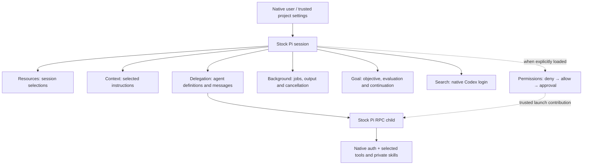

# Architecture

Stock Pi owns package resolution, login, model access, native tools, sessions, MCP and the terminal.
Extensions add independently useful capabilities. Importing a shared library does not activate an
extension, start a service or change permissions.

## Delegated work

Each child is a separate Pi process with a recorded session and a configured agent definition.
One native launcher prepares instructions, skills, selected model/thinking, tool entrypoints and
RPC communication. Authentication uses Pi's native user storage; delegation does not maintain a
second login or credential-refresh implementation.

The default scratch workspace collects ordinary files before cleanup. A project workspace writes
directly into the parent's project. Workspaces organize output; neither is OS confinement. The
parent brokers agent messages and correlated results. Acknowledgement means dispatch, not task
completion. Quiet progress does not start an idle parent turn; questions and completed results can.
See [delegation](guides/delegation.md) and [delivery](reference/events.md).

Selected native tool extensions, including search and background jobs, can load in children.
An explicit agent tool list narrows the parent's available set. Private bundle skills remain
available without being selected for the parent. Child guidance resolves saved personal/project
choices plus the bundle; temporary parent guidance selections are not inherited. Native MCP connections are not transferred to
children; parent MCP remains stock Pi's responsibility. Trusted executable extensions can register
hooks as well as tools; a tool list does not isolate their initialization code.

## Processes, goals and usage

`pi-background` supplies managed Bash jobs, bounded output and cancellation. Delegation reuses the
same process library and works independently when the jobs extension is absent. Process limits,
closed handles and output bounds protect lifecycle correctness; they are not sandbox permissions.

`pi-goal` keeps the saved objective separate from automatic continuation. A configured independent
evaluator assesses fixed criteria. The extension owns deadline/budget checks, continuation and
wait delivery. Evaluator judgement is evidence to inspect, not proof of correctness.

Child, classifier and evaluator usage uses shared receipts forwarded into native tool-result
usage, with IDs for deduplication across delivery and resume. `/costs` keeps detailed accounting
and missing-usage explanations. See [accounting](accounting.md).

## Optional permissions

`pi-permissions` checks each tool call before it runs. Deny rules win, then allow rules; anything
else is left to the mode: run it, ask you, or ask a classifier model. Calls that run keep Pi's
normal host access. Child agents receive the parent's settings and user messages at launch.
See [the permission package](../packages/pi-permissions/README.md).

## Resources

Native packages contain extensions, skills, prompts and themes. Our metadata reader additionally
recognizes `pi.agents` and `pi.instructions`, since Pi has no equivalent resource types. It reads
already resolved package roots; it does not install packages or rebuild excluded native skills.
Session setup changes selected guidance and active tools, never executable package installation.
[Package decisions](package-design.md) explain these boundaries.
