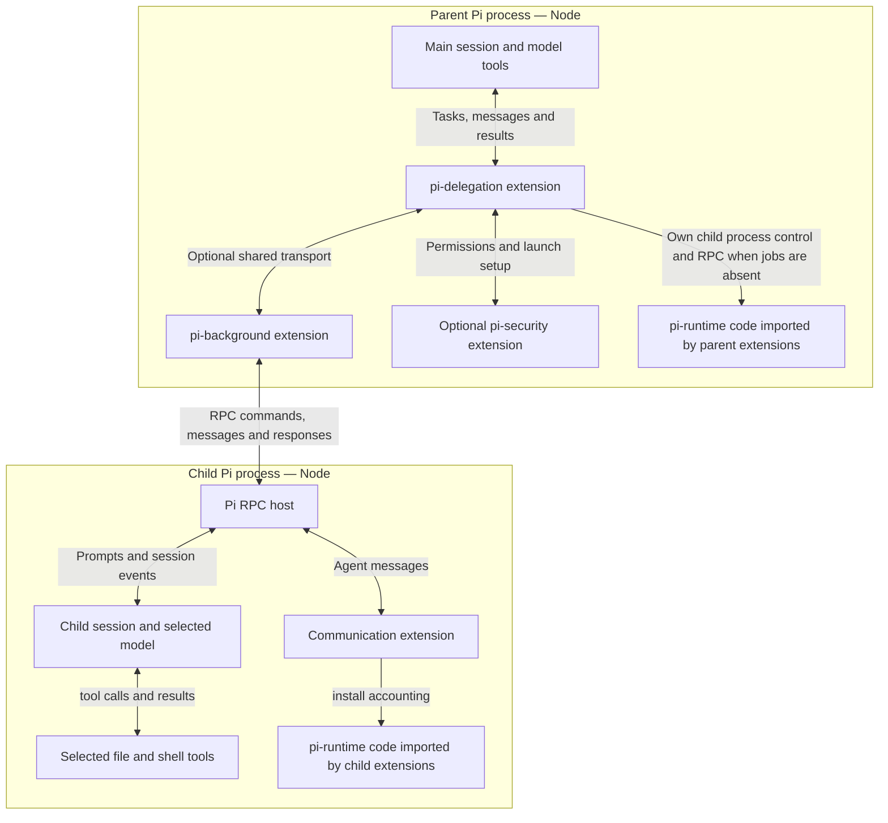

# Architecture

A **Pi process** is a running instance of the Pi CLI or SDK. **Node** runs the JavaScript that makes up Pi and its extensions. The parent process hosts the main session; each delegated agent gets a separate child Pi process and session. A child is not a thread in the parent's Node process.

An **extension** registers tools, commands, or event handlers with its host Pi process. A **package** groups distributable code and its dependencies. Seven packages provide extensions, including the opt-in permission gate; `pi-contracts`, `pi-runtime`, and `pi-resource-browser` provide shared libraries. Importing a library does not activate a separate service, daemon, or sibling extension. See the [thin-slice decisions](decisions/native-thin-slices.md) for independent loading and retained boundaries.

`pi-resource-browser` supplies the shared searchable, keyboard-driven resource picker used by `pi-delegation` and `pi-context`. It depends on Pi's TUI and coding-agent APIs but owns no session state or resource policy; each extension supplies entries and persistence callbacks.

`pi-runtime` code executes in whichever Pi process imports and calls it. In the parent, it resolves child resources and authentication, installs launch files, collects artifacts, and records reported usage. Children load its `child-auth` entrypoint to register the selected provider. Accounting code runs in both parent and child processes that use it; the parent aggregates child reports. The library name does not mean “the child runtime.”

Parent and child communicate through **RPC (remote procedure call)**: the parent sends JSON commands through the child process's input stream, and the child returns events and responses through its output stream.

The arrows show requests and responses, not extra worker processes. Parent and child messages travel through the parent broker. The child communicates with its parent and live siblings; it cannot spawn or cancel agents. Permission requests use a separate security channel and reach the human UI in manual mode.

## Workspaces and private configuration

A **workspace** is the child's working directory: the place it uses to prepare files. The default scratch workspace is a new private directory under a temporary launch folder. A project workspace uses the parent's project directory directly, so changes are immediately shared.

Each launch also creates **private child configuration directories** for instructions, selected skill files, provider credentials, and an isolated Pi agent directory. These hold session setup data rather than project artifacts. Their locations depend on the launch provider. With security enabled, policy protects them from model file and shell tools. Private directory permissions alone do not confine a child launched without security that has the same host privileges.

| Workspace | Security disabled | Security enabled | Result retention |
| --- | --- | --- | --- |
| `scratch` — default | Available; tools have host permissions | Available; effect tools use narrowed child policy | Ordinary workspace files are copied to the parent's result store before cleanup |
| `project` | Available; uses the parent directory directly | Refused | Returns a reference to the project with `owned: false` |
| Git worktree or project copy | Not implemented | Not implemented | No corresponding tool option |

Workspace placement organizes files. It provides filesystem confinement only when effect tools are governed by the security policy and kernel executor. See [delegation](guides/delegation.md) for retaining and integrating artifacts.

## Responsibilities and boundaries

`pi-delegation` owns agent discovery, capability previews, identities, request correlation, and result delivery. It asks a child-launch provider to prepare resources, then gives the prepared command to `pi-background`. The unrestricted provider reports host permissions. The security provider narrows authority before launch. Selected or active security that is missing, malformed, duplicated, or unable to launch produces an error; it never selects the unrestricted provider as a fallback.

`pi-background` owns subprocess lifetime, bounded output, stdin for trusted protocol clients, and cancellation. Its model tool can list, inspect, read, or cancel existing processes. Raw process launch is available only through the trusted extension interface. With `PI_SECURITY_TRANSPORT=extensions`, security routes all secured shell calls through this session-owned process manager; a foreground wait can be handed off while the process and its prepared capability lease continue. Process groups clean up ordinary descendants; deliberate daemon or session escapes remain a limitation. See [shell jobs](guides/background-processes.md).

`pi-security` owns policy, approvals, replacement file/shell tools, and confined helpers. On macOS, those helpers execute under Seatbelt. On Linux, shell execution is read-only; writable execution is disabled until the sandbox can preserve write-deny rules for paths created after launch. The parent Pi process, model client (including codemode `models.*`), search HTTP adapter, trusted extension code, and user `!` commands are outside tool confinement. Linux/container release closure is separate from the supported macOS host configuration. See [security configuration and limits](guides/security.md).

`pi-goal` owns an explicitly authorized objective and fixed acceptance criteria, parent-provider accounting, continuation, and response waits. The working model performs the task; a separate evaluator assesses fixed criteria when that model settles without an outstanding owned wait. The runtime validates the decision and controls continuation. Evaluator judgement is not independent proof of correctness. Each accepted wait binds to one request and the current goal/session scope. A completed response takes one delivery route: the goal wait or ordinary notification. Its result still needs review. Usage accounting observes provider events independently of the route that delivers a reply; checking or waiting does not charge it again.

## Implementation map

- [Launch selection](../packages/pi-delegation/extensions/subagent.ts), [unrestricted provider](../packages/pi-delegation/lib/subagent/unrestricted-launcher.ts), and [security provider](../packages/pi-security/src/child-launch.ts).
- [Shared resource setup](../packages/pi-runtime/src/child-resources.ts), [authentication](../packages/pi-runtime/src/child-auth.ts), [accounting](../packages/pi-runtime/src/accounting.ts), and [artifact collection](../packages/pi-runtime/src/artifacts.ts).
- [Background transport](../packages/pi-background/extensions/background-process.ts) and [RPC dialogue](../packages/pi-delegation/lib/subagent/rpc-dialogue.ts).
- [Goal waits](../packages/pi-goal/extensions/goal.ts) and [producer response offers](../packages/pi-delegation/lib/subagent/owned-waiter.ts).

The [package reference](reference/packages.md) lists entrypoints; the [event reference](reference/events.md) specifies the interfaces that cross these boundaries.

## Native packages and session selection

[Package decisions](package-design.md) records why native Pi owns installation, identity, filters
and reload, while agent bundles, selected behavior instructions and session selections remain in
extensions. Security and shared dependencies use ordinary native/npm packaging; package selection
never replaces the permission mechanism.
