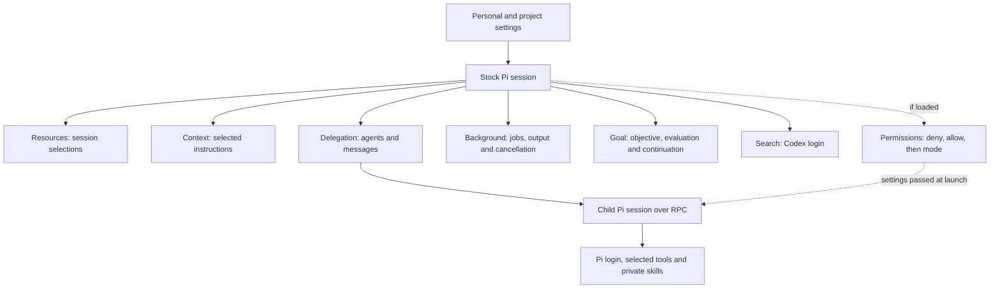
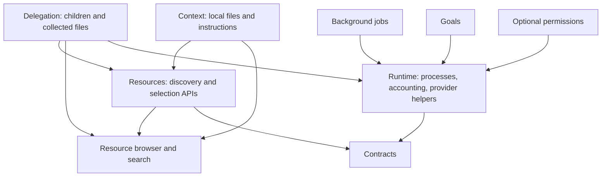

# Architecture

Stock Pi handles package loading, login, model access, built-in tools, sessions, MCP and the
terminal. Each extension here adds one feature on top. Importing a shared library never starts an
extension, a service or a permission check.

## Child sessions

Each child is a separate Pi process with its own saved session and an agent definition. One
launcher sets up its instructions, skills, model, thinking level, tools and RPC connection. The
child logs in through Pi's normal user storage; there is no second login system.

By default a child works in a scratch directory. Its files are collected when it closes. In
project mode it writes straight into the parent's project. Neither mode restricts what the child
can access.

The parent routes messages between agents and matches answers to requests. A launch reply means
the task was sent, not finished. Progress messages do not wake an idle parent; questions and
finished answers do. See [delegation](guides/delegation.md) and [events](reference/events.md).

Children can load the parent's package tools, such as search and background jobs. An agent's
`tools` list can only narrow the parent's set. An agent's private skills reach only that agent.
Children use saved personal and project choices plus their own bundle. They ignore choices the
parent made just for its current session.

MCP connections stay with the parent and are not passed to children. Extensions that a child loads
can run setup code and register hooks, not only tools, so a tool list does not isolate them.

## Jobs, goals and usage

`pi-background` runs Bash jobs, keeps a bounded amount of output and cancels jobs. Delegation uses
the same process library and works without the jobs extension. The limits on jobs and output keep
lifecycles tidy; they are not security limits.

`pi-goal` stores the objective separately from the decision to keep going. A separate evaluator
model checks fixed criteria. The extension handles deadlines, budgets, continuation and waiting
for child answers. Treat the evaluator's verdict as evidence to check, not proof.

Usage from children, the permission classifier and the goal evaluator is recorded once and added
to Pi's normal totals. `/costs` shows the breakdown and explains anything missing. See
[accounting](accounting.md).

## Permissions

`pi-permissions` checks each tool call before it runs. Deny rules win, then allow rules. Anything
else goes to the mode: run it, ask you, or ask a classifier model. Calls that run have your normal
user access. Children get the parent's settings and your messages when they launch. See
[the permission package](../packages/pi-permissions/README.md).

## Resources

Pi packages can hold extensions, skills, prompts and themes. These packages also read two extra
fields, `pi.agents` and `pi.instructions`, because Pi has no built-in type for them. The reader
only looks at packages Pi has already resolved. It never installs packages or brings back skills
Pi excluded. Changing a session's resources changes guidance and active tools, never which code is
installed. See [package design](package-design.md).

## Shared libraries

The `pi-resources` library subpaths never import or start its extension. Each loaded extension
registers its own tools and commands. Moving code between packages kept the accounting and session
event names and saved entry formats, so no user state is migrated or rewritten.
