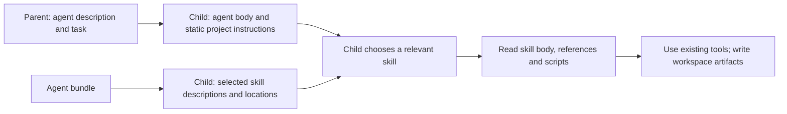

# Delegate work

Load `pi-delegation`; add `pi-background` for managed shell jobs. The [walkthrough](../getting-started.md) shows native loading. Browse effective resources before assigning work; a definition names choices within the live parent tool set.

## Define and discover an agent

Use either a flat Markdown definition in the user agent directory's `agents/` or a directory bundle. Project definitions may live in a trusted ancestor's `.pi/agents/` or `.agents/agents/`:

```markdown
---
name: reviewer
description: Use to review a proposed change for correctness.
tools: [read, bash]
conversation: none
---
Review the assigned change. Report actionable findings with file paths and evidence.
```

A bundle keeps the exact `<name>/<name>.md` entrypoint beside private resources:

```text
agents/
└── reviewer/
    ├── reviewer.md
    ├── skills/
    │   └── review-check/
    │       ├── SKILL.md
    │       └── scripts/check.mjs
    ├── references/
    ├── scripts/
    ├── templates/
    └── assets/
```

Only flat root `*.md` files and immediate `<name>/<name>.md` entrypoints are discovered as agents. Nested Markdown files remain bundle resources. Directory symlinks resolve to their canonical source, and duplicate names produce a deterministic diagnostic. A flat definition is a single Markdown file without an agent-owned resource directory. A bundle's skills stay private to its child: the parent catalogue exposes the agent description and effective tools/scope, not those skills. Malformed, unreadable, or escaping-link skill resources produce a content-free discovery warning; parser details and skill text are not included in the parent prompt. The child stages ordinary bundle files with write bits removed and source execute bits retained so relative references and scripts continue to work. Links resolving within the bundle are copied as ordinary files; links escaping it are refused. `.git` entries and internal links resolving into `.git` metadata are omitted. Staging is limited to 2,048 filesystem entries and 16 MiB of file content per bundle; a bundle above either limit is refused. File modes help prevent accidental edits but do not isolate same-user processes.

`/agents` shows definitions, effective settings, invalid files, ignored trust levels, collisions, overrides, and which definitions this project can use. Discovery walks from the working directory to the filesystem root, nearest first, checking `.pi/agents` before `.agents/agents` at each level. Project definitions require an explicit directory trust decision; a nearer definition wins and a project replacement of a user definition is reported. Definitions reload when browsing or launching.

Use `/agents trust /absolute/project/directory` to grant interactive, session-only trust to a discovered ancestor level. Project trust saved by Pi is also recognized. User-directory definitions are loaded after trusted project levels. The home source directory `~/.agents/agents` is excluded from project levels because shared configuration tooling can deploy it to the user directory.

`/agents enable NAME`, `/agents disable NAME`, `/agents none`, `/agents all`, and `/agents inherit` control the trusted agent selection for this session. A filtered-out agent cannot be launched by guessing its name. `/skills` supports the same actions for public skills. The optional `pi-resources` extension owns `/skills`, filters the parent's advertised skills and manual `/skill:name` invocation, and supplies the public selection inherited by children. Without it, delegation inherits Pi's native loaded skills. Private bundle skills remain child resources.

## Browse project resources

`/agents`, `/skills`, `/instructions` and `/packages` change session choices by default, using the same history state as the model-facing [`session_setup` tool](../reference/tools.md#session-setup). Enter/Space toggles a resource without saving settings or reloading Pi. Close the window to keep that session choice.

- Ctrl+S saves project defaults in trusted `.pi/settings.json`.
- Ctrl+Shift+S saves personal defaults for new sessions across projects, excluding project-only resources.

The three individual pickers save only their own category; `/packages` saves guidance categories from loaded providers, including individual choices; absent providers' defaults are preserved. Explicit project choices override personal choices per resource; Inherit follows the personal default. Legacy exact lists, including `[]`, retain their existing meaning until edited. Existing sessions retain recorded choices on resume. `inherit` resets only the requested session category to saved defaults, preserving project settings and other session choices.

For example, project A saves instruction 1 with Ctrl+S. Project B can turn that instruction on or off in personal defaults; new A sessions still use A's saved list. A session already started in B retains its own choices until explicitly changed.

`/agents` and `/skills` open a framed, searchable browser in the prompt area above the footer.
Closing it restores the input prompt and any text it contained. The left pane shows the catalogue and
session selection; the right pane follows the highlighted resource with its description,
source and instructions. Agent details include the resolved model, thinking level, tools,
skills, conversation setting and launch scope. A capability error appears in that pane.
Manual-only skills are labelled: selecting them does not advertise their descriptions to the
model when their metadata disables model invocation.

Type to search, or press `/` to focus the search input. Search uses BM25 over names,
descriptions and declared agent metadata, with prefix expansion for incomplete words. It does
not index instruction bodies or search the network. An empty query restores the catalogue.

| Input | Action |
|---|---|
| Up / Down | Move through results; when details have focus, scroll that pane |
| Enter | Toggle the highlighted resource for this session |
| Space | Toggle while the list has focus; enter a space while searching |
| Tab | Switch between the list and details |
| Page Up / Page Down | Move through results or scroll details |
| Escape / Ctrl+C | Close; successful saved changes remain |

In Pi's alternate-screen TUI, clicking a row toggles it and the mouse wheel scrolls the pane
under the pointer. Main-screen and RPC clients retain keyboard/native-dialog operation.
Narrow terminals place details below the list. The browser follows the active Pi theme.

Toggles apply only to this session. Failed changes keep the previous selection and display the
reason in the browser. Saving defaults preserves unrelated settings and does not reload Pi.
Closing during a save waits for its result. The parent must be idle; existing children keep their
prepared resources. Saving project defaults requires project trust. Explicit `enable`, `disable`,
`none`, `all`, `inherit` and `inspect NAME` commands remain available for scripted or RPC use.

The layout follows established [fzf preview](https://github.com/junegunn/fzf/blob/master/ADVANCED.md)
and [Bubble Tea list](https://github.com/charmbracelet/bubbletea/tree/main/examples) patterns,
implemented with Pi's native custom UI, input, Markdown and mouse APIs.

An omitted `skills` field in an agent definition inherits the project's selected public skills and adds every skill in that agent's bundle. `skills: []` selects none; an explicit list narrows across both public and private skills, with a bundle skill winning a same-name collision. Bundle skills need no separate parent registration. Deliberately exporting one through a public skill path makes it independently selectable by the parent. See [agent metadata](../reference/configuration.md#agent-definitions) for the exact rules.

Security-off children inherit the parent's selected task tools, including native package tools
such as `codex_search` and `background_process`. An explicit agent `tools` list narrows that set;
`tools: []` selects none. Delegation messaging stays bound separately. Parent orchestration tools
(`subagent`, its lifecycle tools and `session_setup`) are not inherited.

The launcher takes entrypoints from Pi's native tool source metadata and loads them through Pi's
resource loader. Native tool filtering excludes unselected sibling tools from the same extension.
No second package catalogue or extension opt-in field is needed. Inline SDK tools without a
loadable source and native MCP connections cannot be transferred. Existing children keep their
launch-time selection.

Children use Pi's native authentication backing at the original agent directory, so search can
use Codex OAuth even when the worker model belongs to another provider. Resource settings and
transcripts stay isolated and in memory: starting a child never installs configured packages.
Each child owns its jobs; `bash({command: "…", background: true})` returns a job ID for that child's
`background_process` calls. Closing the child stops its remaining jobs.

The separate secured launcher still restricts children to its existing tool set; equivalent native
selected native package tools load through Pi in the child.

### Use private skills and scripts

The entrypoint body establishes the child's role. Selected skills supply descriptions and staged
`SKILL.md` locations through Pi's native skill catalogue; their bodies stay out of the initial
prompt. Give each skill a useful description so the child can choose it when relevant, rather than
requiring every skill to load at startup. Manual-only skills are not advertised automatically;
the child needs `read` or `bash` to use Pi's skill catalogue.

For example, `reviewer.md` can select `skills: [review-check]` while the parent selects no skills.
The child can read `review-check/SKILL.md`, then execute its `scripts/check.mjs` relative to that
skill's advertised location. Scripts are ordinary files used through existing tools, not extra
tools or automatically executed instructions.

Direct supporting paths in the agent body, such as `scripts/check.mjs`, resolve against the staged
directory disclosed in the child's `<agent_bundle path="…" />` block. Skill-relative paths resolve
against their own `SKILL.md` directory. Both remain separate from the child's writable workspace;
write outputs there. This also makes bundle scripts usable with `skills: []`.



## Assign a task

Give the parent the definition name, objective, relevant paths, acceptance criteria, and expected output. A child with `conversation: none` gets no parent transcript. Sharing conversation includes only user/assistant text; tool results, thinking, and extension messages are excluded.

A model-facing launch call looks like this:

```json
{
  "agent": "reviewer",
  "task": "Review /absolute/project/src/parser.ts against its documented input contract. Return findings with source evidence.",
  "workspace": "scratch"
}
```

Call `subagent` with that input after reviewing the catalogue. Before each parent run, the catalogue advertises only launchable definitions, with effective tools and scope. Launch rechecks those capabilities; if they changed, it refuses the attempt and returns the updated preview for review before retrying.

Use the optional `model` parameter to select an authenticated Pi model for that launch, for example `"model": "openai-codex/gpt-6-luna:low"`. The catalogue labels each agent's model selection as `selectable` or `fixed` and lists the available model IDs. A model pinned in the agent definition is fixed; a conflicting request returns an error before any process starts. Omit `model` to use that definition's default or inherit the parent model. User-defined `thinking` and model-suffix levels retain their documented precedence.

The acknowledgement contains `agent_id`, `workspace`, `workspace_mode`, `tools`, `scope`, and `request_id`, plus `wait_id` when an active goal accepts a response wait. It means the RPC prompt was dispatched, not that the assignment is complete. Tool `details` also reports effective model, thinking, permission mode, and conversation settings.

If startup fails and cleanup also fails, the closed child remains available in `agent_list`; inspect it with `subagent_check`, retry cleanup with `subagent_close`, and use `/agents` to read the diagnostic.

The selected definition body becomes child instructions. Task text is separate user-message data. Pi's static project files are carried into the child with their source paths and original project path; frontmatter is removed. The parent's known `instructions` section is carried separately under `<instructions>`, including selected behavior snippets and caller guidance. These categories describe source and purpose, not instruction priority. The child disables its own Pi context-file discovery, so files in its agent directory, workspace, or ancestor directories do not add instructions implicitly. Goal state, running-agent snapshots, and counters are not inherited as static child instructions. Conversation text is shared only through the explicit `conversation` setting. Protected startup information binds the child identity, parent identity, and workspace. Effect tool selection is narrowed to the parent's active resources; communication tools are added independently. Resource bundles and private skills do not widen filesystem or network permissions. An empty effect-tool list can still leave `agent_message` and `agent_list` available.

## Choose where files go

| Choice | Use it for | Availability and consequence |
| --- | --- | --- |
| `scratch` — default | Preparing an artifact for parent review | The child's own directory is retained until collection |
| `project` | Editing the shared project directly | Edits are immediately visible in the parent project |

Both modes use ordinary host permissions. Scratch placement organizes artifacts; it is not a
sandbox. Git worktree and project-copy modes are not implemented.

## Exchange messages and read responses

Launch and close results append running state to the conversation; child presence does not rewrite the system prompt. Use `agent_list({})` for reachable identities and states. Use the returned ID, not the definition name, to address a running session:

```json
{
  "to": "agent-access-action-active",
  "message": "Include a minimal failing input for each finding.",
  "mode": "steer"
}
```

`agent_message` acknowledges broker/RPC acceptance, not reading, acceptance of a revised task, or an answer. Set `kind: "progress"` for routine telemetry to the parent only, for example `agent_message({to: parentId, kind: "progress", message: "Validation is running"})`; it uses native quiet delivery and never starts an idle parent turn. Progress addressed to a child or sibling is refused; use `kind: "question"` or `"message"` for actionable coordination. Omitted `kind` defaults to `message`. `steer` queues text for the recipient's next safe boundary after current tool work; it does not interrupt a tool. `followUp` waits for the current run to finish. Questions and messages can start a new turn when the recipient is idle. Children can message the parent and live siblings but cannot spawn, cancel, or reach unrelated Pi sessions.

Completed responses are retained and automatically delivered at the parent's successful turn boundary, or start a turn when it is idle. `subagent_check({id, after})` reads a bounded page after a sequence cursor. It returns at most four replies and 32 KiB of text, with the complete serialized tool response capped at 32 KiB; each reply contributes at most 8 KiB. For a longer reply, continue with its `replySequence` and `nextTextOffset` values. The offset is a UTF-8 byte offset. A check consumes a pending ordinary notification only after contiguous pages from byte offset zero cover the full retained history and any longer queued delivery copy; reading a later page first does not consume it. The history remains readable again. After close, JSON escaping may leave the archived copy shorter than the queued reply; reading that archive does not consume the longer notification, which remains for ordinary parent delivery. A failed or aborted parent run retains pending replies without automatically waking. With an accepted goal wait, use [goal waiting](goals.md#wait-for-a-child-response) for its correlated response. Accounting is independent of these delivery routes.

Automatic parent delivery is bounded to 64 replies or a combined 4 MiB budget for encoded result envelopes and gap notices, including XML escaping, with at most 64 per-agent gap summaries. A single envelope larger than the budget is omitted and reported in a gap notice. If the reply queue reaches either limit, older notifications are dropped from automatic delivery and an explicit gap notice names the agent and sequence range. If more than 64 agents have gaps, the parent receives a bounded aggregate warning. Use `subagent_check` to inspect retained history for active or recently closed children; check `retainedFrom` and `lostReplies` before treating the assignment as complete. Closing or cancelling a child stops the process, collects its artifacts, and returns a compact state summary rather than the transcript. Its reply history remains available through `subagent_check` for up to 30 minutes, subject to a four-child and 8 MiB process-local cap; Pi session shutdown, session-tree changes, replacement, or history eviction removes it. `discard` affects collected artifacts only and does not erase reply history. A close or cancel response marks collected artifacts as discarded when the same call deletes them. Repeating close or cancel during that retention window is safe.

Agent files and bundle-private skills are rescanned when `/agents` browses or a child launches, so changing either does not require Pi's `/reload`. The model-facing catalogue is built at the start of each parent turn, so an agent added during a turn may not appear until the next turn. If an agent is new or its effective tools or scope changed, inspect the displayed preview and retry the launch. A selected-agent list may require `/agents enable NAME`; this changes the session lookup immediately without stopping children. Public skills are loaded by Pi: run `/reload` after adding a public skill or changing its configured path. Selecting an already discovered public skill does not reload Pi. Reloading replaces the extension runtime and closes active child agents. `/agents trust` lasts only for the current Pi session and is cleared on reload or session replacement; saved Pi project trust persists across reloads, so only directories trusted solely with `/agents trust` need to be trusted again.

A message or completed response is dialogue data, not new human authorization. The optional gate handles permission review before calls. See the [event reference](../reference/events.md) for routing and delivery guarantees.

## Retain and integrate artifacts

Inspect the child's result, review its files and evidence, and integrate accepted work into the project. Closing or cancelling a scratch child collects ordinary files before removing its temporary launch folder. Process exit, parent shutdown, and branch changes use the same collection path.

`subagent_close({id})` and `subagent_cancel({id})` return:

```json
{
  "artifacts": {
    "id": "artifact-access-action-active",
    "directory": "/absolute/agent/subagent-results/session-id/artifact-access-action-active",
    "files": ["review.md"],
    "omitted": ["external-link"],
    "owned": true,
    "scope": "scratch-collection",
    "externalEffects": "untracked",
    "fileCount": 1,
    "omittedCount": 1,
    "moreFiles": 0,
    "moreOmitted": 0,
    "truncatedPaths": 0
  }
}
```

`scope` distinguishes a scratch collection from a project reference. `externalEffects: "untracked"` means writes outside scratch and shell/API effects are not inventoried; an empty `files` list never certifies their absence. Inspect project diffs, status including untracked files, and declared output paths before integration.

The file lists show at most eight paths each, with each path preview limited to 128 characters.
Counts report the full result, `moreFiles` or `moreOmitted` indicate additional paths, and
`truncatedPaths` counts listed paths whose preview was clipped. Use the returned artifact directory
to inspect the complete collection. Close and cancel results include a `closedHistory` summary; use
`subagent_check` with the same agent ID to read replies in bounded pages.

The store is under the parent agent directory's `subagent-results/<session-id>/`. Paths in `files` and `omitted` are relative to the retained directory. Configuration/credentials, the child's agent directory, and `.git` are excluded from collection; symlinks and multiply linked files are reported in `omitted` rather than copied. Collection is capped at 5,000 files, 256 MiB, and 20,000 directory entries. If collection fails, the partial copy is removed and the launcher leaves the original scratch path untouched for inspection, including after session shutdown. It never follows a replacement symlink. Child credentials and launch metadata are cleaned independently. Remove the retained workspace when it is no longer needed. The collector verifies the scratch workspace identity recorded before launch, so replacing its parent path cannot redirect the read. Collection runs after the owned child process group stops. Node's path-based filesystem APIs cannot pin directory handles for relative opens, so a separate host process that deliberately escapes that group and races collection could redirect reads or writes; artifact collection is not an isolation boundary against such a process.

After closing a project child, `directory` references the parent project and `owned` is false, `scope` is `project-reference`, and `files` is empty; inspect project changes directly. `discard: true` deletes an owned collected copy; it never deletes or rolls back direct project edits. Re-read needed retained files using the returned directory, because the original scratch path no longer exists after successful cleanup.

Implementation and checks: [agent discovery](../../packages/pi-delegation/lib/subagent/agents.ts), [launcher](../../packages/pi-delegation/lib/subagent/child-launch.ts), [artifacts](../../packages/pi-runtime/src/artifacts.ts), [Pi 1.2.0 native integration](../../packages/pi-delegation/lib/subagent/native-delegation-stock.test.ts), and [live message delivery](../../packages/pi-delegation/lib/subagent/live-delivery-stock.test.ts).

## Permission review in child sessions

Children use the same native launcher and ordinary host permissions. When the parent loads the
optional gate, its trusted policy and genuine root-user messages accompany child initialization.
Worker-authored tasks remain distinct from user authorization. Allow rules skip classification;
deny rules block; unmatched calls use the inherited review mode. Manual clients must be capable
of answering approval requests. See [permissions](../../packages/pi-permissions/README.md).
