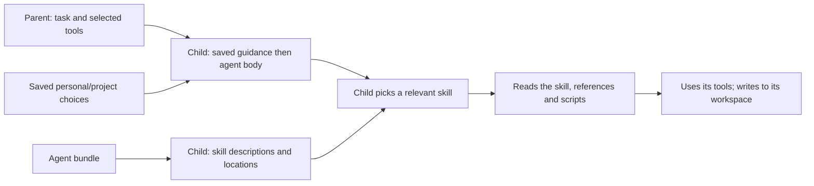

# Delegate work

Load `pi-delegation` to hand tasks to child Pi sessions. Add `pi-background` if children should
run background shell jobs. The [walkthrough](../getting-started.md) shows how to load both.

The usual flow:

1. Define an agent.
2. Check it in `/agents`.
3. Ask the parent to delegate a task.
4. Read the child's answer and review its files.
5. Close the child.

## Define an agent

An agent is a Markdown file. Put it in your user agent directory's `agents/` folder, or in a
trusted project's `.pi/agents/` or `.agents/agents/` folder, in the working directory or any
parent directory:

```markdown
---
name: reviewer
description: Use to review a proposed change for correctness.
tools: [read, bash]
conversation: none
---
Review the assigned change. Report actionable findings with file paths and evidence.
```

The body becomes the child's instructions. The front-matter picks its resources and is removed
from the instructions. See [agent metadata](../reference/configuration.md#agent-and-skill-selection).

For an agent with its own skills or scripts, use a bundle: a folder with `<name>/<name>.md` as the
entrypoint.

```text
agents/
└── reviewer/
    ├── reviewer.md
    ├── skills/
    │   └── review-check/
    │       ├── SKILL.md
    │       └── scripts/check.mjs
    ├── references/
    ├── scripts/
    ├── templates/
    └── assets/
```

Only top-level `*.md` files and `<name>/<name>.md` entrypoints count as agents. Other Markdown in
a bundle is just a bundle file. A bundle's skills are private to its child: the parent sees the
agent's description, tools and scope, but not its skills.

Discovery details:

- Directory symlinks resolve to their real location.
- Duplicate names produce a clear diagnostic.
- A malformed or unreadable skill, or one whose link leaves the bundle, produces a warning without
  its content. Parser errors and skill text never reach the parent's prompt.

When a child launches, its bundle is copied to a staging directory. Files lose write permission
and keep execute permission, so relative paths and scripts still work. Links inside the bundle are
copied as ordinary files; links that leave it are refused. `.git` entries, and links into `.git`,
are left out. A bundle over 2,048 entries or 16 MiB is refused. Read-only files help prevent
accidental edits but do not stop other processes running as you.

## Find and trust agents

`/agents` shows each agent, its settings, invalid files, ignored trust levels, name clashes,
overrides and which agents this project can use.

Discovery starts at the working directory and walks up to the filesystem root, nearest first. At
each level it checks `.pi/agents` before `.agents/agents`. User-directory agents come after
project levels. The nearer agent wins, and `/agents` reports when a project agent replaces a user
one. Agents are re-read whenever you browse or launch.

Project agents need you to trust their directory. `/agents trust /absolute/project/directory`
trusts a discovered level for this session only, after you confirm. Project trust saved by Pi also
counts. `~/.agents/agents` is never treated as a project level, because tools that share
configuration may deploy it into your user directory.

Choose which trusted agents this session can use:

- `/agents enable NAME` and `/agents disable NAME`
- `/agents none` and `/agents all`
- `/agents inherit` to go back to saved defaults

An agent that is switched off cannot be launched by guessing its name. `/skills` has the same
actions for public skills. It comes from the optional `pi-resources` extension and controls which
skills the parent advertises and which `/skill:name` commands work.

## Browse and select resources

`/agents`, `/skills`, `/instructions` and `/packages` all open the same searchable browser above
the footer. They change choices for this session, using the same session record as the model's
[`session_setup` tool](../reference/tools.md#session-setup). Toggling never saves settings or
reloads Pi. Close the browser to keep your choices. Closing restores your prompt, including any
text you had typed.

- **Ctrl+S** saves project defaults in the trusted project's `.pi/settings.json`.
- **Ctrl+Shift+S** saves personal defaults for new sessions in any project, leaving out
  project-only resources.

`/agents`, `/skills` and `/instructions` each save only their own category. `/packages` saves the
categories of every loaded extension, including individual choices, and keeps the defaults of
extensions that are not loaded. An explicit project choice beats the personal one for that
resource; Inherit follows the personal default. Resumed sessions keep their recorded choices.
`inherit` resets only that category of this session to the saved defaults.

For example: project A saves instruction 1 with Ctrl+S. In project B you can turn instruction 1 on
or off in your personal defaults, but new sessions in A still use A's list. A session already
running in B keeps its own choices until you change them.

The left pane lists resources and session choices. The right pane shows the highlighted
resource's description, source and instructions. For agents it also shows the model, thinking
level, tools, skills, conversation setting and scope, plus any error. Skills marked manual-only are
labelled: selecting one does not advertise it to the model.

Type to search, or press `/` to focus the search box. Search ranks names, descriptions and agent
metadata with BM25 and matches partial words. It does not search instruction text or the network.
Clear the search to see everything.

| Key | Action |
|---|---|
| Up / Down | Move through results, or scroll the details pane when it has focus |
| Enter | Toggle the highlighted resource for this session |
| Space | Toggle when the list has focus; types a space while searching |
| Tab | Switch between list and details |
| Page Up / Page Down | Page through results or details |
| Escape / Ctrl+C | Close; saved changes stay saved |

In Pi's full-screen TUI you can click a row to toggle it and scroll the pane under the mouse.
Main-screen and RPC clients use the keyboard or Pi's dialogs. Narrow terminals put details below
the list. The browser uses the current Pi theme.

If a change fails, the previous selection stays and the browser shows why. Saving keeps unrelated
settings and does not reload Pi. Closing while a save runs waits for it to finish. The parent must
be idle, and running children keep their resources. Saving project defaults needs project trust.
The `enable`, `disable`, `none`, `all`, `inherit` and `inspect NAME` commands still work for
scripts and RPC.

The layout follows [fzf's preview](https://github.com/junegunn/fzf/blob/master/ADVANCED.md) and
[Bubble Tea's list](https://github.com/charmbracelet/bubbletea/tree/main/examples), built with
Pi's own UI, input, Markdown and mouse APIs.

## Choose a child's skills

A new child starts from the skills saved in personal and project settings, not the parent's
session choices, then adds its bundle skills. So the parent can have no skills selected while its
child still gets saved and bundle skills.

| Agent `skills` | Child gets |
| --- | --- |
| Omitted, `"*"` or `["*"]` | Saved personal and project skills plus every bundle skill |
| `[one, two]` | Only these, from the bundle or Pi's loaded skills |
| `[]` | None |

Quote `"*"` in YAML and use it on its own. Named skills can include loaded skills that are off in
your saved defaults. Missing names are skipped, with a warning in `/agents` and in the launch
reply. If a bundle skill and a loaded skill share a name, the bundle wins; otherwise Pi's own
choice stands, and Pi reports its own clashes. Package skills can be selected by any session, and
an agent can name them. Skills Pi excluded stay excluded.

## Child tools and login

Children get the parent's selected task tools, including package tools such as `codex_search` and
`background_process`. An agent's `tools` list narrows that set, and `tools: []` gives none.
Messaging tools are added separately. The parent's own control tools (`subagent`, its lifecycle
tools and `session_setup`) are never passed on.

The launcher finds each tool's entrypoint from Pi's tool source data and loads it with Pi's
resource loader. Other tools from the same extension stay off. Inline SDK tools with no loadable
source, and MCP connections, cannot be passed on. Running children keep the tools they started
with.

Children log in through Pi's normal auth storage in your agent directory, so search can use your
Codex login even when the child's model is from another provider. Their settings and transcripts
are kept in memory, and starting a child never installs packages.

Each child owns its jobs. `bash({command: "…", background: true})` returns a job ID for that
child's `background_process` calls. Closing the child stops its jobs.

## Use private skills and scripts

The agent's body sets its role. Its skills appear in the child's skill list with a description and
the location of the staged `SKILL.md`; their text is not in the starting prompt. Write good
descriptions so the child picks the right skill when it needs one. Manual-only skills are not
listed. The child needs `read` or `bash` to use skills at all.

For example, `reviewer.md` can set `skills: [review-check]` while the parent selects no skills.
The child reads `review-check/SKILL.md` and then runs `scripts/check.mjs` relative to that skill.
Scripts are ordinary files used with ordinary tools; nothing runs them automatically.

Relative paths in the agent body, such as `scripts/check.mjs`, resolve against the staged bundle
named in the child's `<agent_bundle path="…" />` line. Paths in a skill resolve against that
skill's folder. Both are separate from the child's workspace, where it should write its output.
Bundle scripts therefore work even with `skills: []`.



## Assign a task

Tell the parent which agent to use, the objective, the relevant paths, how to judge success and
what to return. A child with `conversation: none` sees none of the parent's conversation. When
conversation is shared, only user and assistant text is included; tool results, thinking and
extension messages are not.

The model's launch call looks like this:

```json
{
  "agent": "reviewer",
  "task": "Review /absolute/project/src/parser.ts against its documented input contract. Return findings with source evidence.",
  "workspace": "scratch"
}
```

Before each parent run, the agent list in the prompt shows only agents that can launch, with their
tools and scope. Launch checks again. If anything changed, it refuses and returns the new preview
so the parent can review it and retry.

To pick a model for one launch, pass `model`, for example
`"model": "openai-codex/gpt-6-luna:low"`. The prompt marks each agent's model as `selectable` or
`fixed` and lists available models. A model set in the agent file is fixed, and asking for a
different one fails before anything starts. Leave `model` out to use the agent's default or the
parent's model. Thinking levels from the agent file or a model suffix follow their usual order.

The launch reply contains `agent_id`, `workspace`, `workspace_mode`, `tools`, `skills`, `scope`
and `request_id`. It adds `warnings` when skills were missing and `wait_id` when an active goal is
waiting for the answer. It means the task was sent, not finished. The result's `details` also give
the effective model, thinking level and conversation setting. See the
[tool reference](../reference/tools.md#delegation-tools).

If startup fails and cleanup fails too, the child stays in `agent_list`. Inspect it with
`subagent_check`, retry cleanup with `subagent_close`, and read the error in `/agents`.

### What the child receives

In order, the child's instructions contain:

1. Pi's static project context files from the parent, with their source paths and original
   project path, with front-matter removed.
2. Instruction choices saved in personal and project settings, rendered fresh by `pi-context` in
   an `<instructions>` section, if that extension is loaded.
3. The agent's body.

The task arrives separately, as a user message. These sections add no new priority levels. The
parent's session-only instruction choices and its rendered instruction section are not copied, and
neither are goal state, the running-agent list or counters. Conversation is shared only through
the `conversation` setting.

The child does not look for context files itself, so files in its agent directory, workspace or
parent directories add nothing. Its startup data fixes its own ID, its parent's ID and its
workspace. Its tools are limited to the parent's active tools, with messaging added separately.
Bundles and private skills never widen file or network access. Even with no task tools, a child
still has `agent_message` and `agent_list`.

## Choose where files go

| Workspace | Use it for | What happens |
| --- | --- | --- |
| `scratch` (default) | Preparing files for the parent to review | The child gets its own directory, kept until its files are collected |
| `project` | Editing the project directly | Changes appear in the parent's project straight away |

Both run with your normal user permissions. Scratch is for keeping output tidy, not a sandbox. Git
worktree and project-copy modes do not exist.

## Messages and answers

Launch and close results add the child's state to the conversation; they do not change the system
prompt. `agent_list({})` shows reachable agents and their state. Address a running child by its ID,
not its agent name:

```json
{
  "to": "agent-access-action-active",
  "message": "Include a minimal failing input for each finding.",
  "mode": "steer"
}
```

Message kinds:

- `progress`: routine updates to the parent only. They are delivered quietly and never wake an
  idle parent. Progress sent to a child or sibling is refused.
- `question` or `message` (the default): things that need action. They can start a turn when the
  recipient is idle.

Delivery modes:

- `steer` (the default) delivers at the recipient's next safe point, after its current tool call.
  It does not interrupt a tool.
- `followUp` waits until the recipient's current run ends.

The receipt means the message was accepted for delivery. It does not mean it was read, that a
changed task was accepted, or that there is an answer. Children can message the parent and live
siblings. They cannot start, cancel or reach other Pi sessions.

### Reading answers

Finished answers are kept and delivered to the parent at the end of its next successful turn, or
start a turn if the parent is idle. If a parent run fails or is aborted, answers wait for the next
prompt instead of waking it. If a goal is waiting on the answer, see
[goal waiting](goals.md#wait-for-a-child-response). Accounting does not depend on which route
delivers an answer.

`subagent_check({id, after})` reads one page of answers after a sequence number. A page has at
most four answers, 8 KiB per answer and 32 KiB in total, including the whole tool response. For a
longer answer, pass its `replySequence` and `nextTextOffset` (a UTF-8 byte offset) to read on.

Reading with `subagent_check` clears the pending notification only once you have read every page
from the start, covering the full answer and any longer queued copy. Reading a later page first
does not clear it, and history stays readable afterwards. After close, JSON escaping can make the
archived copy shorter than the queued answer. Reading the archive then leaves the longer
notification for normal delivery.

Automatic delivery to the parent holds up to 64 answers in just under 4 MiB (4 MiB less 128 KiB),
counting escaped XML and gap notices, with up to 64 per-agent gap summaries. When it fills up, the
oldest notifications are dropped and a gap notice names the agent and sequence range. An answer
too large for the budget on its own is replaced by a gap notice. With gaps for more than 64 agents,
the parent gets one combined warning. Before treating a task as done, check `retainedFrom` and
`lostReplies` in `subagent_check`.

Closing or cancelling a child stops it, collects its files and returns a short summary, not the
transcript. Its answer history stays readable with `subagent_check` for up to 30 minutes, for at
most four closed children and 8 MiB in this process. Session shutdown, tree changes, session
replacement or eviction remove it sooner. `discard` deletes collected files only, never history.
Closing or cancelling again during that window is safe.

## Collected files

Read the child's answer, review its files and evidence, and copy what you accept into the project.
Closing or cancelling a scratch child collects its ordinary files before its temporary folder is
removed. Process exit, parent shutdown and branch changes collect files the same way.

`subagent_close({id})` and `subagent_cancel({id})` return:

```json
{
  "artifacts": {
    "id": "artifact-access-action-active",
    "directory": "/absolute/agent/subagent-results/session-id/artifact-access-action-active",
    "files": ["review.md"],
    "omitted": ["external-link"],
    "owned": true,
    "scope": "scratch-collection",
    "externalEffects": "untracked",
    "fileCount": 1,
    "omittedCount": 1,
    "moreFiles": 0,
    "moreOmitted": 0,
    "truncatedPaths": 0
  }
}
```

- `scope` is `scratch-collection` for collected files or `project-reference` for project mode.
- `externalEffects: "untracked"` means writes outside scratch, and shell or API side effects, are
  not listed. An empty `files` list does not mean there were none. Check the project diff, untracked
  files and any output paths you asked for.
- `files` and `omitted` show at most eight paths each, each cut to 128 characters. The counts
  cover everything. `moreFiles` and `moreOmitted` say how many paths are not shown, and
  `truncatedPaths` how many shown paths were cut. Open the directory to see everything.
- The result also has a `closedHistory` summary. Use `subagent_check` with the same ID to read
  answers page by page.

Files are kept in the parent agent directory under `subagent-results/<session-id>/`. Paths are
relative to that folder. Configuration, credentials, the child's agent directory and `.git` are not
collected. Symlinks and files with several hard links are listed in `omitted` instead of copied.
Collection stops at 5,000 files, 256 MiB or 20,000 directory entries.

If collection fails, the partial copy is removed and the original scratch folder is left for you to
inspect, even after shutdown. Collection never follows a replaced symlink. Child credentials and
launch data are cleaned up separately. Delete the kept files when you no longer need them.

Collection runs after the child's process group stops, and checks that the scratch folder is the
one recorded at launch, so swapping its parent path cannot redirect the copy. Node's path-based
file APIs cannot pin directories, though: a separate process running as you that leaves the group
and races the copy could still redirect it. Collection is not a security boundary.

For a project-mode child, `directory` points at the project, `owned` is false, `scope` is
`project-reference` and `files` is empty; look at the project changes directly. `discard: true`
deletes an owned collected copy and never touches project edits. Use the returned directory to
re-read files, because the scratch folder is gone after cleanup.

Source and tests: [agent discovery](../../packages/pi-delegation/lib/subagent/agents.ts),
[launcher](../../packages/pi-delegation/lib/subagent/child-launch.ts),
[collected files](../../packages/pi-delegation/lib/subagent/artifacts.ts),
[Pi 1.2.0 integration](../../packages/pi-delegation/lib/subagent/native-delegation-stock.test.ts)
and [live delivery](../../packages/pi-delegation/lib/subagent/live-delivery-stock.test.ts).

## When changes take effect

- **Agent files and bundle skills** are re-read when `/agents` opens or a child launches. No
  `/reload` needed.
- **The agent list in the prompt** is built at the start of each parent turn, so an agent added
  mid-turn may appear only next turn. If an agent is new or its tools or scope changed, review the
  preview and retry the launch.
- **Agent selection.** If agents are filtered, you may need `/agents enable NAME`. This applies at
  once and does not stop children.
- **Public skills** are loaded by Pi. Run `/reload` after adding one or changing its path.
  Selecting an already loaded skill needs no reload.
- **`/reload`** replaces the extension runtime and closes running children.
- **`/agents trust`** lasts for this Pi session and is cleared by reload or session replacement.
  Trust saved by Pi survives reload.

A message or answer from an agent is conversation, not your approval. Permission checks happen
before calls, in the permission package. See [events](../reference/events.md) for routing and
delivery details.

## Permissions in children

Children use the same launcher and your normal user permissions. If the parent loads
`pi-permissions`, each new child gets the parent's current mode and rules, including anything you
allowed for the session, plus your messages, keeping the newest if the launch data would pass 96 KiB. The classifier sees the child's task as the parent
agent's words, not yours. Approval prompts from a child appear in the parent's UI. If the parent
has no UI, those calls are blocked. See [permissions](../../packages/pi-permissions/README.md).
