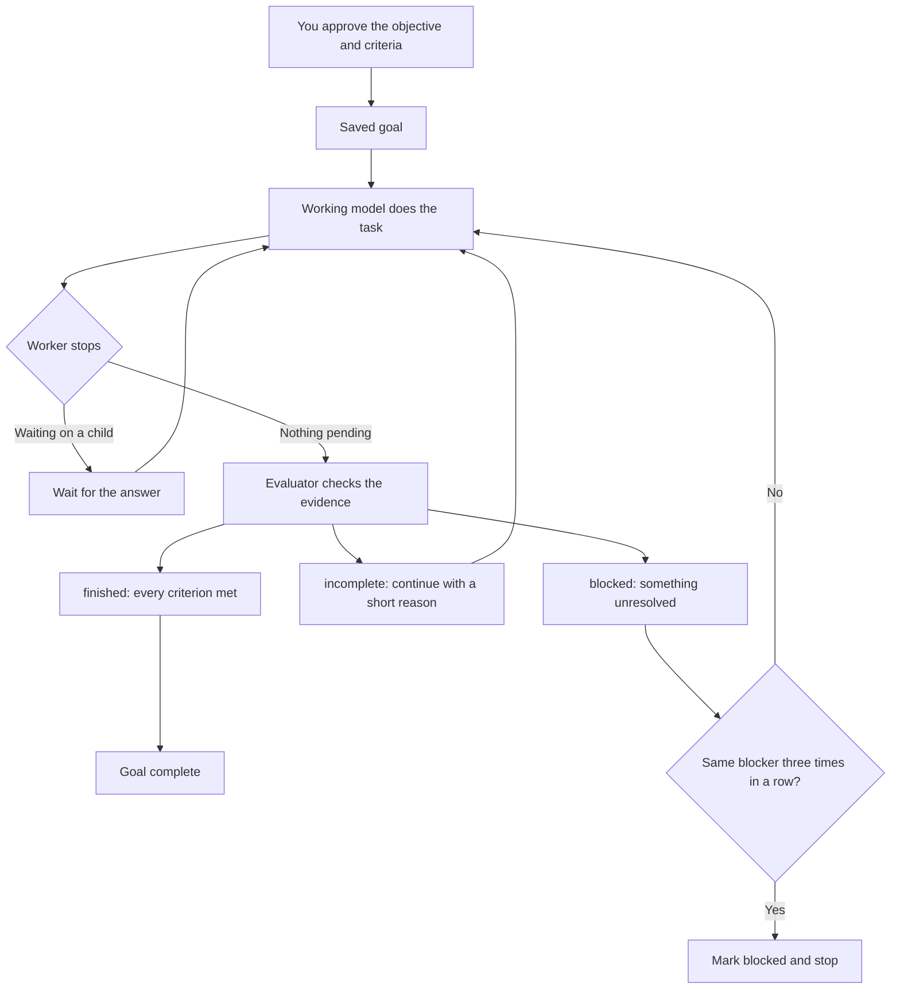

# Goals

`pi-goal` keeps Pi working toward one objective until its criteria are met. The working model does
the task. Each time it stops, a separate evaluator model checks the evidence. Then the extension
continues, marks the goal complete or reports a blocker.

## Start a goal

```text
/goal Build a CSV parser that passes the tests and has a usage README.
```

This saves the objective and sends it as your next message, so work starts at once.
`/goal start`, `/goal edit` and `/goal resume` also send the objective, so you never need a second
prompt. Prompt-template expansion is off for that message.

The model can also propose a goal with `create_goal(...)`. You confirm the exact objective first.
That starts the goal within the current run without sending another message.

## Commands

| Command | What it does |
| --- | --- |
| `/goal <objective>` | Start or replace the goal and begin work on that exact objective |
| `/goal` or `/goal status` | Show status, criteria, evaluator assessments and usage |
| `/goal edit <objective>` | Replace the objective and clear earlier assessments; budget and usage stay |
| `/goal pause` | Stop automatic work. A deadline keeps running |
| `/goal resume` | Allow automatic work again, with a fresh evaluation history, and continue |
| `/goal resume --for <duration-or-timestamp>` | Give an expired goal a new deadline and resume |
| `/goal resume --no-deadline` | Remove an expired goal's deadline and resume |
| `/goal clear` | Drop the goal |

`start`, `edit`, `pause`, `resume`, `clear` and `status` are commands when they come first after
`/goal`. If your objective starts with one of those words, use `/goal start <objective>`.

When you type an objective, that text is the approval. A typed objective is the goal's single
criterion. Custom criteria, from `create_goal`, are fixed when the goal is approved.

Limits: up to 12 criteria. The objective and each criterion can be up to 12,000 characters, and
together up to 24,000 characters and 4,096 tokens by Pi's estimate. This keeps the whole goal in
the evaluator's view.

## Set a deadline

Put `--for` before the objective:

```text
/goal start --for 2h Build the CSV parser and document it.
/goal edit --for 2026-10-11T15:00:00+01:00 Finish the parser before review.
/goal resume --for 30m
```

`--for` takes a duration such as `30m`, `2h` or `1d`, or an RFC 3339 timestamp with a timezone. A
duration is turned into a fixed time when you run the command, at most 3,650 days ahead. A new goal
without `--for` has no deadline. Editing or resuming without a deadline option keeps the current
one. `/goal edit --no-deadline <objective>` removes it.

The clock keeps running while the goal is paused and while Pi is closed. If the deadline passes
while Pi is closed, the goal is marked expired when the next session opens.

When a goal expires:

- No new goal-driven turns start.
- An active goal wait is cancelled and its result is held back.
- A turn already running may finish.
- Children and background jobs keep running.

To carry on, resume with a new `--for` or with `--no-deadline`. To start something unrelated, run
`/goal clear` first.

The status bar shows the local due time and how long is left. A completed goal shows its due time
without a countdown. The model sees the fixed timestamp, not a countdown.

## Clear a goal

`/goal clear` drops the current objective and returns to normal work. It stops the current goal run
and evaluator and cancels old waits and pending `create_goal` approvals. Late replies cannot bring
the goal back. Children, their files, the conversation and usage records are untouched. Clearing
when there is no goal does nothing harmful, and it also repairs a branch whose saved goal state is
broken. Afterwards, `/goal <new objective>` starts fresh.

## How evaluation works

When the working model finishes a run and is not waiting on a child, the evaluator gets the
objective, the criteria, the original request and recent rounds of work and assessment.



The evaluator returns `finished`, `incomplete` or `blocked`, a short reason, and an assessment
with evidence for every criterion. `finished` only counts if every criterion is `met`. The
extension checks the reply's shape and scope, but the verdict is still the evaluator's judgement.
Tests and other evidence still matter.

The same blocker three times in a row stops automatic work and marks the goal `blocked`. An
`incomplete` verdict resets the count, and a different blocker starts a new one. Waiting on a child
does not count. Fix the problem, then `/goal resume`; that also resets the count.

The evaluator's input is bounded. Oversized evidence is cut with a notice, and older rounds may be
left out. The full record stays in the session log, and the evaluator is told that missing evidence
cannot prove completion. Editing or resuming starts a new evaluation history.

If the evaluator's reply is malformed, Pi saves it with the error and asks once more, sending the
error and a short excerpt. Both tries share the original timeout. A second bad reply stops
automatic work. Login, network, timeout, abort, truncation and context-limit errors are not
retried.

While automatic work is stopped you can still send messages; they run without goal instructions.
`/goal resume` continues the goal once the evaluator problem is fixed.

## Choose the evaluator

There is no default evaluator model. Choose a logged-in model when you start Pi:

```sh
pi --goal-evaluator-model provider/model \
   --goal-evaluator-timeout 30
```

The timeout is in seconds. It defaults to 30 and can be at most 2,147,483.647 seconds. You can
also set both in [settings](../reference/configuration.md#goal-evaluator-settings).

The working model has `create_goal`, `get_goal` and `wait_for_goal_event`. It has no tool to mark
progress, completion or blockers itself. See the [goal reference](../reference/goals.md) for
validation, history, accounting and lifecycle details.

## Understand the budget

A token budget counts the working model's input, output, cache reads and cache writes across its
requests, including tool loops. One request can go past what is left. If usage is missing or
incomplete, automatic work stops when a budget is set.

With no budget there is no limit, and the model is not shown running totals; `/goal` still shows
them. Evaluator calls appear in `/costs` and are not part of the budget. Budgets are separate from
context windows and account limits.

## Wait for a child response

When the working model delegates or messages a child during a goal, the reply can include a
`wait_id`. Do other useful work first, then call `wait_for_goal_event` with that ID. The wait owns
the pending answer, so the model does not have to keep polling.

`/background` or a steering message ends the wait but keeps the same `wait_id` and the pending
answer. It does not cancel the child. Review and use the answer before finishing.

The status bar shows `waiting` during a wait and `N wait handles pending` after it ends;
`/goal status` shows the same count. Several handles can point at the same answer. See
[owned response waits](../reference/goals.md#owned-response-waits) and
[shell jobs](background-processes.md).
