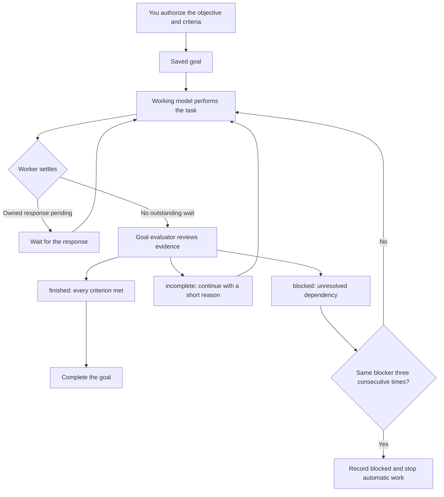

# Keep work on a goal

Use `pi-goal` to keep Pi working toward one objective and its acceptance criteria. The working model
performs the task. A separate goal evaluator checks the evidence when the working model stops,
then the runtime decides whether to continue, complete the goal, or report a blocker.

## Start work

Set a goal and the objective starts immediately:

```text
/goal Build a CSV parser that passes the tests and has a usage README.
```

The command records and authorizes the objective, then queues it as the working model's user message.
`/goal start`, `/goal edit`, and `/goal resume` likewise queue the authorized objective so work
starts or continues without a second prompt. `create_goal(...)` is different: it authorizes a goal
within the current run and does not enqueue another user message.

## Limit a goal by time

Put `--for` before the objective to set a deadline. Relative durations start when the command runs;
timestamps must include a timezone.

```text
/goal start --for 2h Build the CSV parser and document it.
/goal edit --for 2026-10-11T15:00:00+01:00 Finish the parser before review.
/goal resume --for 30m
```

`--for` accepts a positive duration such as `30m`, `2h`, or `1d`, or an RFC 3339 timestamp with an
explicit timezone. Durations resolve once to an absolute timestamp, no more than 3,650 days away. A
new goal without `--for` has no deadline. Editing or resuming without a deadline option preserves
the current deadline. Use `/goal edit --no-deadline <objective>` to remove one, or
`/goal resume --no-deadline` to reopen an expired goal without a deadline.

The absolute deadline keeps elapsing while the goal is paused or Pi is closed. If Pi is closed when
the deadline passes, `pi-goal` records the goal as expired when the next session opens or goal state
is synchronized. Expiry cancels an active goal-owned wait call and prevents future automatic goal
continuation. A model turn already in progress may finish; its wait result is withheld, while child
and background processes continue independently. This deadline stops new goal-driven continuations;
it does not forcibly terminate work already running. Resume the same objective with a new `--for`
duration or `--no-deadline`; use `/goal clear` first to discard it and start an unrelated objective.
The TUI status shows the local due time and a compact remaining interval while the goal is unfinished.
A completed goal keeps its due time without a frozen countdown. Model context includes the fixed
absolute timestamp, not a changing countdown.

| Action | Behavior |
| --- | --- |
| `/goal <objective>` | Starts or replaces the goal, then begins work on that exact objective. |
| `/goal` or `/goal status` | Shows status, criteria, evaluator assessments, and accounting. |
| `/goal clear` | Removes the goal and revokes its pending waits, evaluation and automatic continuation. |
| `/goal pause` / `/goal resume` | Stops or reauthorizes automatic work. Resume starts a new scoped evaluation history and continues the objective. Deadlines keep running while paused. |
| `/goal resume --for <duration-or-timestamp>` | Extends an expired goal and resumes it. |
| `/goal resume --no-deadline` | Removes the deadline and resumes an expired goal. |
| `create_goal({objective, criteria?, budget?, deadline?})` | Requests confirmation of the exact objective, optional criteria, budget, and deadline; trusted embedding code can supply matching authorization. |

A typed objective directly authorizes that text. Custom criteria are fixed when authorized together
with the objective. Editing replaces the criterion and clears earlier assessments, while preserving
budget and accounting. Starting, editing, or resuming queues a normal user message containing the
authorized objective, with prompt-template expansion disabled.

Use up to 12 concrete criteria. The objective and each criterion can be at most 12,000 characters;
their combined evaluator evidence must fit 24,000 characters and 4,096 Pi-estimated tokens. This
keeps the full authorized scope available to the evaluator. It returns concise, evidence-backed
results and clips oversized source output before adding it to its bounded context.

`start`, `edit`, `pause`, `resume`, `clear`, and `status` are control words when they appear first after `/goal`.
Use `/goal start <objective>` for an objective beginning with one of those words.

## Clear a goal

Use `/goal clear` to abandon the current objective and return to ordinary interactive work.
It records that no goal is active, revokes old wait handles and creation grants, and stops the
current goal run and evaluator. Late responses cannot revive the goal. Child agents, their
workspaces, conversation history and cost records continue independently. Clearing an absent goal
is harmless; it also recovers a branch whose saved goal or waiter state is malformed. After clearing,
`/goal <new objective>` starts fresh.

## Understand evaluation

When the worker finishes a run with no outstanding owned response wait, the evaluator receives the
authorized objective, fixed criteria, initial request context, and recent worker/evaluator cycles.
The history is bounded: oversized source evidence is truncated with a notice, and older whole cycles
may be omitted from the evaluator request. Full evidence records remain in the session log, and
omitted content cannot establish that a criterion is met.



The evaluator returns `finished`, `incomplete`, or `blocked`, a short reason, and an evidence-backed
assessment for every criterion. `finished` is accepted only when every criterion is `met`. The
runtime validates the response and scope; the evaluator's judgement is not independent proof of
correctness. Tests and other task evidence still matter.

Three consecutive fresh evaluations reporting the same unresolved blocker stop automatic work and
record `blocked`. `incomplete` resets that count; a different blocker starts a new count. Waiting for
an acknowledged child response does not count as a blocker evaluation. Resolve the dependency, then
use `/goal resume` to continue. Resume resets the consecutive blocker count; a repeated condition
then starts a fresh assessment streak.

If the evaluator returns a completed response that fails validation, Pi saves the raw response and
validation error, then makes one corrective assessment request with the error and a bounded response
excerpt. Both attempts share the original timeout. A second invalid response stops automatic
continuation. Authentication, transport, timeout, aborted, truncated, and context-limit errors do
not get a corrective retry. Manual messages remain available while automatic work is disarmed;
those messages run without goal instructions. Use `/goal resume` to continue the objective after
resolving the evaluator problem.

Evaluator requests keep the authorized objective and original request context, then include recent
worker/evaluator cycles within a bounded input budget. Oversized evidence is truncated with a notice;
older whole cycles may be omitted from the request, while full records remain in the session. The
evaluator is told that omitted evidence cannot prove completion. Resume and edit create a new
scoped evaluation history.

## Select the evaluator

Select an authenticated evaluator explicitly with `--goal-evaluator-model`. No provider is selected by default. Choose a model
and timeout at launch. The positive timeout defaults to 30 seconds and cannot exceed 2,147,483.647 seconds:

```sh
pi --goal-evaluator-model provider/model \
   --goal-evaluator-timeout 30
```

The worker exposes `create_goal`, `get_goal`, and `wait_for_goal_event`. It does not set progress,
completion, or blocker status through an `update_goal` tool. See the [goal reference](../reference/goals.md)
for output validation, history, accounting, and lifecycle details.

## Understand the budget

An explicit token budget counts worker input, output, cache reads, and cache writes across dispatched
main-model requests, including tool loops. One dispatched request can overshoot the remaining amount.
Missing or incomplete worker usage stops automatic continuation under an explicit budget.

An omitted budget means unlimited. Goal state shown to the worker then omits accumulated usage totals;
`/goal` still shows accounting. Evaluator calls are recorded separately in `/costs` and are outside the
explicit worker budget. These budgets are separate from provider context windows and account limits.

## Wait for a child response

Do useful independent work before calling `wait_for_goal_event` with the exact `wait_id` returned by
an acknowledged delegation or message. The wait owns that pending response and avoids repeated model
requests. `/background` or a steering message yields the foreground wait but leaves the same
`wait_id` and pending result available; it does not cancel the child or discard its response. Inspect
and integrate the result before finishing the task. The status footer shows `waiting` while a
foreground wait is active and `N wait handles pending` after the wait yields; `/goal status` reports
the same pending-handle count. The count is owned wait handles, which may refer to the same response.
See [owned response waits](../reference/goals.md#owned-response-waits) and [shell job handoff](background-processes.md).
