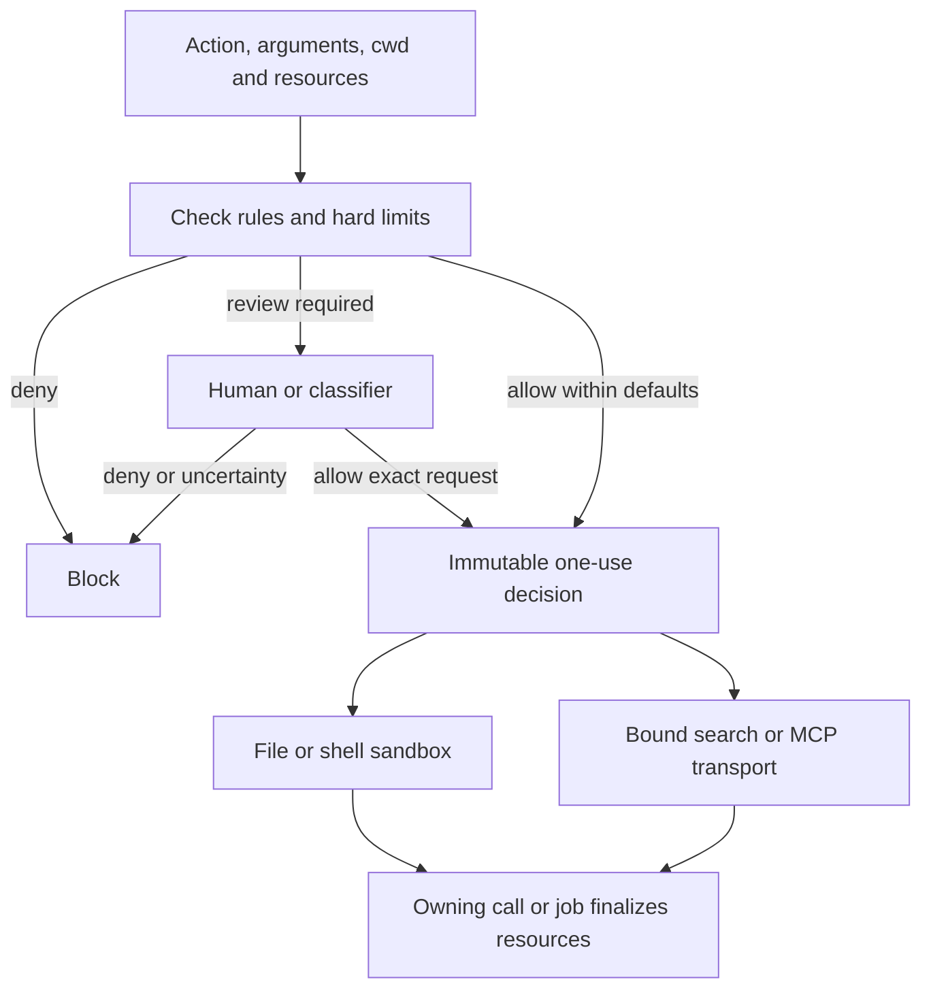

# Security policy

The host chooses a trusted policy file through `PI_SECURITY_POLICY`. Project files and tool
arguments cannot replace it. Use the [host template](../../packages/pi-security/src/host-policy.json)
as a starting point and keep the policy outside model write access.

## Configuration

```json
{
  "version": 2,
  "mode": "auto",
  "classifier": { "model": "openai-codex/gpt-6-luna" },
  "resources": {
    "network": ["pypi.org", "files.pythonhosted.org"]
  },
  "allow": [
    { "tool": "read" },
    { "tool": "write" },
    { "tool": "edit" },
    { "tool": "bash" }
  ],
  "deny": [
    { "tool": "bash", "match": { "program": "sudo" } }
  ]
}
```

| Field | Meaning | Default |
|---|---|---|
| `version` | Policy format | Required: `2` |
| `mode` | Who reviews requests: `manual` for a person, `auto` for the classifier | Required |
| `resources.write` | Default writable files or directories | `["${project}", "${tmp}"]` |
| `resources.denyRead` | Files or directories unavailable to model reads | `[]` |
| `resources.denyWrite` | Files or directories unavailable to model writes | `[]` |
| `resources.network` | Host ceiling for shell and tool transports; `"*"` permits approval of any public host | `[]` |
| `classifier.model` | Authenticated model selected by the host | `none` |
| `classifier.timeoutSec` | Classifier response deadline | `15` |
| `approvalTimeoutSec` | Human approval deadline | `120` |
| `env.path` | Host-selected executable search directories | Host runtime path |
| `env.assignAllow` | Shell variables that may be assigned in a command | `[]` |
| `allow`, `deny` | Action rules | `[]` |

Timeouts must be positive and within Node's timer range. Unsupported fields and invalid values
fail validation. [Types](../../packages/pi-security/src/types.ts) and
[validation](../../packages/pi-security/src/policy.ts) define the schema.

`${project}` is the starting project's real path; `${tmp}` is the session-owned temporary
directory; `${agent}` is Pi's trusted agent directory. Absolute paths and `~/` are supported.
Project Git metadata uses ordinary write permissions: `git init` can create configuration and sample hooks within a writable project. Protect specific repositories or Git metadata with `resources.denyWrite` when needed.

Tool caches use the session temp by default. Paths do not grant access to protected runtime,
launch metadata or other agents' temporary directories.

## Action rules

A rule requires `tool`, the exact Pi tool name. Optional `match` fields narrow which calls it
covers; omitting `match` covers all calls to that tool. Deny rules take precedence and do not
invoke an approver.

`id` is an optional diagnostic label. Unnamed rules appear as `allow[0]`, `deny[0]`, and so on
in logs and errors; these positions do not affect matching or permissions. Explicit IDs must
be valid and unique across both lists. Child-launch clients using `allowIds` select only
explicitly named allow rules; omitting that selector inherits named and unnamed rules alike. Bash rules can match programs, subcommands, literal arguments, paths and
supported wrappers. File rules can match read or write paths. Other tools match by name.
See [matcher source](../../packages/pi-security/src/matcher.ts).

An allow rule can narrow its default resource permissions:

```json
{
  "tool": "bash",
  "match": { "program": ["pwd", "git"] },
  "permissions": { "write": false, "network": [] }
}
```

For bash, `match.program` names the executable and `match.subcommand` names the subcommand;
either accepts a string or an array of exact alternatives. `args-contain` matches literal
arguments, `paths` selects read/write scope, and `wrappers` selects supported command wrappers.
File tools support `match.paths`; other tools use their exact tool name.
Allow-rule subcommands match the first argument. Deny-rule subcommands conservatively match
any argument token, including after options such as `git -C repo push`; a quoted argument
with the same exact token can also match a deny rule.

Write and network access are independent. A process can have network access without writable
project files. There are no task-based security classes or rank ordering. A rule's defaults
are distinct from a child's hard resource limits. Local control tools default to no network;
bound remote adapters infer their actual endpoint. Shell rules may use the configured host
baseline unless an explicit rule narrows it.

## Decision and execution pipeline

Every call describes an action and its resources. The gate checks hard exclusions and action
rules, then asks the selected approver when the action or additional access requires review.
Approval authorizes that exact request; it cannot invent paths, hosts or new device capabilities.



The decision contains independent write and network permissions, canonical requested file
paths, and any required parent creation. The binding freezes that decision and checks the exact
call ID, arguments and working directory. An ended session or replaced policy invalidates
pending preparation. Shared [permission algebra](../../packages/pi-security/src/permissions.ts)
is used by admission, profiles and network adapters.

Local helpers compile kernel profiles. Search and MCP use their bound transport capabilities;
remote tools do not become OS-contained processes merely because local writes are disabled.
See [events and lifetime](events.md#security-service) and [architecture](../architecture.md).

## Requested resources

File tools infer write access from their destination. Bash can request additional resources:

```json
{
  "command": "printf '%s\\n' Passed > /workspace/service-b/notes/result.txt",
  "permissions": { "write": ["/workspace/service-b/notes/result.txt"] }
}
```

Existing directories grant their subtree; file destinations grant the exact file and creation
of missing parent directories. Canonical paths, file/directory kind and parent creation are
included in review and cache identity. File helpers for additional destinations are separate
from cached default helpers and can write only the approved target. Shell jobs retain their
default writable roots plus approved additions for that job's lifetime.

`permissions.network` requests additional destinations within `resources.network`. Additional
hosts extend the action rule's defaults; hard host ceilings remain binding. A bare configured
host permits ports 80 and 443; `host:port` permits only that port. Fixed-origin search and bound
MCP adapters supply their actual destination and port themselves. Application-tool arguments
named `permissions` remain application data; only the secured bash schema exposes this request
field. Network hosts and filesystem paths are not interchangeable permissions.

Sandbox resource grants retain protected paths, explicit denials and child resource limits. Exact-file
write additions reject files with multiple hardlinks; additional directory grants leave existing
hardlinked files unreadable and unwritable. Symlink changes invalidate reviewed destinations.
Ordinary foreground process groups end with their owning call; background grants last until
job finalization. A yielded foreground wait does not terminate a managed background job.

## Automatic classification

The classifier receives genuine user messages from the selected session branch, the worker's preceding explanation
or exposed reasoning, the exact tool arguments, working directory and requested permissions.
Child tasks, agent dialogue, retrieved text and worker claims are evidence, not user authority.
Later user restrictions override earlier permission. The original task is retained across short follow-up messages. Each child receives a user-intent snapshot at launch. The classifier input has a 64 KiB limit; oversized input is refused rather than silently removing authority or restrictions.

`allow` authorizes a requested or ordinarily necessary action whose effects match that intent.
`deny` identifies a conflicting action or unnecessarily broad request. `ask` means the evidence
is insufficient. Requested deletion can be allowed; deleting unrelated targets cannot.

The resolver permits only `allow`. Missing authentication, timeout, ambiguity, refusal or invalid
output blocks execution. Auto mode does not silently switch to human approval.

Chat classification uses a strict Responses schema through supported OpenAI Responses and
Codex Responses adapters, with tool selection disabled:

```json
{"reason": "The user requested this destination.", "verdict": "allow"}
```

The schema emits a nonempty `reason` first, followed by `verdict`: `allow`, `deny` or `ask`.
The complete JSON object must contain only those fields and finish normally. XML, Markdown fences, repaired partial results, tool
calls and refusals are rejected. The classifier cannot generate new scope. Reasoning is off
when supported, otherwise its lowest available level is used. Native classifier models use
validated provider choice results. See [classifier](../../packages/pi-security/src/classifier.ts).

## Children and host capabilities

Children inherit default access and can narrow write and network limits independently. Their
approval mode selects the resolver only: selecting `auto` does not remove network access or
change write limits. Manual child requests reach the root human UI; automatic requests use the
child's classifier and protected user-intent snapshot.

Host capabilities come from trusted launch configuration, not policy or model arguments.
A macOS development launcher can supply `PI_SECURITY_HOST_CAPABILITIES=gpu` as its normal
baseline. That adds the measured GPU driver and Metal compiler permissions while retaining file,
network and process restrictions. Children inherit that snapshot and cannot add capabilities.
The GPU backend is macOS-only; other executors reject it. See
[host capabilities](../../packages/pi-security/src/host-capabilities.ts).

`host-execution` enables bash requests with `permissions.execution: "host"`. Every such request
requires approval and is bound to its exact command and working directory. Its normalized
permissions are `{"execution":"host","write":true,"network":[["*"]]}`: these describe host access,
not enforced resource grants. Action deny rules still precede approval. Host execution uses no
Seatbelt/bwrap profile or fetch lease and cannot be combined with `permissions.write` or
`permissions.network`. Children with either resource limit disabled cannot select it. Omitted
`execution` and `"sandbox"` use the normal confined executor. See the
[host execution guide](../guides/security.md#run-an-approved-command-on-the-host).

A `resources.network` entry of `"*"` expands the approval ceiling without granting network by
itself. Allow-rule lists and `permissions.network` can explicitly grant `"*"` for arbitrary public
hosts, including redirects. A wildcard rule under an exact host ceiling reduces to that ceiling;
a wildcard tool request requires a wildcard ceiling. All grant groups must admit the destination.
DNS answers must resolve exclusively to public addresses and the outbound address remains pinned.
A refused destination identifies the host and port; private/local destinations remain refused.
