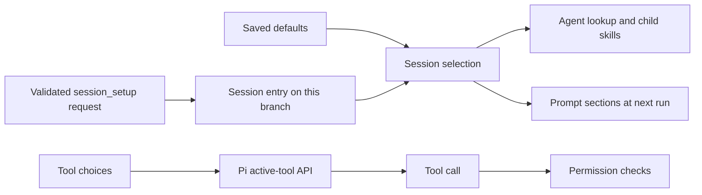

# Tools and commands

These are the tools the extensions give the model. JSON examples are tool inputs, not shell
commands. A tool only exists when its extension is loaded in the current Pi process. If the
permission package is loaded, it can also allow or block each call.

## Session setup

`session_setup` lets the parent choose resources for a task without writing settings. Which
resources it offers depends on what is loaded: `pi-resources` adds skills, `pi-context` adds
instructions and `pi-delegation` adds agents. Each of them installs the same shared service, and
loading one does not load the others. Package groups are built from whatever is available, so they
work in a session with only context or only delegation.

Search uses the same BM25 ranking as the pickers, over names and metadata. It never returns skill
bodies or an agent's private skills and scripts. Manual-only skills are labelled; selecting one
does not list it for the model or load its body.

```json
{"op":"list","query":"evidence","kinds":["packages"],"limit":10}
```

Use the exact package names, skill and agent names, instruction IDs and tool names it returns:

```json
{"op":"apply","packages":["@example/research"],"skills":["check-evidence"],"agents":["evidence-verifier"],"tools":["read","write","bash","subagent","agent_list","subagent_check","subagent_close"]}
```

| Input | Effect |
|---|---|
| `op: "list"` | Show the current selection and what is available; optional `query`, `kinds` and `limit` (1–50) |
| `op: "apply"` with `skills`, `agents`, `instructions` or `tools` | Replace each category you pass; others stay as they are; `[]` clears one |
| `packages` with `apply` | Set available packages; `[]` hides package resources without erasing their individual choices; tools stay unchanged |
| `op: "reset"` | Drop the session's choices and use saved defaults. `kinds: ["agents"]` resets only that category |

Package IDs are `package.json` names, including any npm scope. Skills that Pi's filters or CLI
flags excluded cannot be brought back by selecting their package. Selecting a package makes its resources discoverable, without selecting their contents or changing
which code is loaded. To add a package, use `pi install` or
start a new run with `-e`; extension code changes need an idle `/reload`. Configured and `-e`
packages are found through Pi's resolver, including ones with no skills. Before restarting with
running children, keep their collected files. An unknown package ID returns these next steps and
changes nothing.

### Validation and timing

- The whole request is checked first. An unknown, untrusted or unavailable ID rejects all of it.
  The tool stays available for listing and resetting.
- Tool results show whether each tool is active. Pi's CLI filters can refuse to activate a tool,
  which leaves the previous choice in place.
- Tool changes go through Pi's active-tool API and apply to the next provider request in the same
  run.
- Instruction and skill sections change at the next run, never part-way through one. The reply
  says so.
- New children use the selected agents and public skills. Running children keep what they have,
  and fixed agent models still apply. Until the next parent run, new children get that run's
  existing instruction snapshot, not newly selected snippets.
- Agent files and their bundles are still discovered normally, so edits affect future launches.
  Running children keep their staged copy. The apply reply includes selected agents' fixed models
  and capability previews.

The choice is saved as a custom session entry, outside the model's messages. Resume restores the
current branch's choice; a new session uses saved defaults. Reset does not stop children or delete
files. A branch with no saved choice records the available defaults when first loaded; it cannot
recover earlier, unrecorded choices.

`/packages` offers the same choices in the picker, but toggling a package there keeps your other
individual choices. See [the `/packages` picker](../package-design.md#the-packages-picker) and
[saved defaults](configuration.md#saved-defaults).

For example, open `/packages`, search for `evidence` and toggle `@finngi2/pi-evidence-research`.
The next parent run gets the evidence-attribution instruction text, the `check-evidence` skill's
description and location, and the `evidence-verifier` agent's description and capabilities. The
model reads the skill when it wants to. A launched verifier gets its own agent body and its private
`verify-claims` skill, which the parent never sees. Close the picker to keep the choice for this
session, or press Ctrl+S first to reuse it in new project sessions. Neither loads code or changes
MCP connections.

Setup never installs extensions, hooks or MCP servers, and never changes permission rules. A tool
must already be registered in the session. Pi's deferred and codemode tools can stay callable while
hidden from the active list, so this controls what the model sees, not what it can do. The
permission package, if loaded, still checks every call. A permission rule can allow
`session_setup` by name; otherwise it goes through the normal check.



## Delegation tools

| Tool | Caller | Parameters | Returns |
| --- | --- | --- | --- |
| `subagent` | Parent | `agent: string`, `task: string`; optional `model: string`, `conversation: string`, `workspace: "scratch" \| "project"` | Launch receipt with effective resources |
| `agent_list` | Parent or child | `{}` | Reachable agents with IDs, names and states |
| `agent_message` | Parent or child | `to: string`, `message: string`; optional `kind: "progress" \| "question" \| "message"`, `mode: "steer" \| "followUp"` | Delivery receipt, not an answer |
| `subagent_check` | Parent | `id: string`; optional `after`, `limit` (1–4), `replySequence`, `textOffset` | State and one page of answers; works for running and recently closed agents |
| `subagent_cancel` | Parent | `id: string`; optional `discard: boolean` | Stops the child, collects files, returns a short summary |
| `subagent_close` | Parent | `id: string`; optional `discard: boolean` | Stops the child, collects files, returns a short summary |

`workspace` defaults to `scratch`; `project` works in the parent's project. `conversation` takes
`"none"`, `"all"` or a whole number of turns as a string, up to the agent's own limit.
`progress` messages go only to the parent and never wake it. `question` and the default `message`
can wake the recipient. A receipt does not mean the message was read or a changed task accepted.

### Launch receipt

The text result is JSON with:

| Field | Meaning |
| --- | --- |
| `agent_id` | The running child's ID |
| `name` | Agent name |
| `status` | `"started"` |
| `workspace` | The child's working directory |
| `workspace_mode` | `"scratch"` or `"project"` |
| `tools` | The child's tools |
| `skills` | The child's skill names |
| `warnings` | Only when there are warnings, such as skills that were not found |
| `scope` | Short capability summary |
| `request_id` | ID of the first request |
| `wait_id` | Only when an active goal accepted a wait for the answer |

`details` holds `id`, `requestId`, `waitId`, `warnings` (when present), `effective` (tools, model,
thinking and conversation) and `goalWait` (`"accepted"`, `"handled"` or `"not-registered"`).

### Message receipt

Has `accepted`, `message_id` and `to`. For a message to the parent it adds `mode`, `kind` and
`trigger_turn`; for a message to a child it adds `request_id`, and `wait_id` if a goal accepted a
wait. Receipts for the main agent's messages do not wait for an answer.

### Reading answers

Answers are numbered and carry their `requestIds`. `after` is an answer number, not a byte offset.
A page has at most four answers, 8 KiB per answer and 32 KiB in total, including the whole tool
response. If an answer continues, pass its `sequence` as `replySequence` and its `nextTextOffset`
as `textOffset` to read the next UTF-8 byte range. `nextAfter` only moves past answers the page
returned in full. Results include state, usage, retention gaps and paging fields.

Delivery, clearing of pending notifications and retention after close are described in
[reading answers](../guides/delegation.md#reading-answers). In short: up to four closed children's
histories (8 MiB total) stay readable for 30 minutes in the same session, and automatic delivery
holds up to 64 answers in just under 4 MiB, reporting gaps when it drops older ones.

Usage in the answer panel is what was known when the answer arrived. Later session-stats updates
appear in the next `subagent_check` and in `/costs`. Failures, acknowledgements and empty turns
never become fake answers. Exact RPC state fields are in
[RPC dialogue](../../packages/pi-delegation/lib/subagent/rpc-dialogue.ts).

Close and cancel results describe collected files with `id`, `directory`, up to eight `files` and
`omitted` paths (128 characters each), the full `fileCount` and `omittedCount`, `owned`,
`moreFiles`, `moreOmitted` and `truncatedPaths`. `discard` deletes only an owned collected copy.
Project-mode results have `owned: false`. See
[collected files](../guides/delegation.md#collected-files).

### Dialogue limits

| What | Limit |
| --- | --- |
| Message text | 64 KiB (UTF-8) |
| Child instructions | 256 KiB (UTF-8); NUL characters refused |
| One kept answer | 2 MiB |
| Kept answers per child | 128 answers and 32 MiB |
| Child RPC line without a newline | 4 MiB; larger cancels the child |

Source: [tool registration](../../packages/pi-delegation/extensions/subagent.ts),
[message checks](../../packages/pi-delegation/lib/subagent/messages.ts),
[resource checks](../../packages/pi-delegation/lib/subagent/child-resources.ts) and
[answer retention](../../packages/pi-delegation/lib/subagent/rpc-dialogue.ts).

## Codemode

Pi's built-in `codemode` runs JavaScript in QuickJS and calls tools from it. Those nested calls go
through Pi's normal tool pipeline. These packages do not replace it or add another MCP transport.
Load Pi's built-ins with Pi's normal loader and check Pi's installed docs for their current API.
Model calls made directly through `models.*` are not tool calls, so the permission package does not
check them.

## Background process tool

`background_process({action, id?, cursor?, maxBytes?})` works on jobs owned by its session.
`action: "list"` needs no ID; `"status"`, `"read"` and `"cancel"` need one. The tool cannot start
jobs or write to stdin. Other extensions use the [background service](events.md#background-service)
for that.

`cursor` is a byte offset of zero or more. `maxBytes` is a whole number up to 1 MiB. A read returns
a text preview, `nextCursor`, `retainedFrom` and `gap`. `details` holds the exact chunks with
stream, start and end byte, base64 data and `encoding: "base64"`. A gap means earlier output was
dropped from the buffer.

| Default limit | Value |
| --- | --- |
| Shell commands running at once | 4 |
| Child agents running at once | 16 |
| Finished jobs kept | 32 |
| Output kept per job | 16 MiB |
| Pending input per job | 16 MiB |
| Pending writes per job | 128 |
| Result size | 4 MiB |
| Kill grace and output drain | 1 second each |
| Protocol write timeout | 30 seconds |

`/jobs` lists, reads and cancels jobs. `/background` ends a foreground shell wait or goal wait
without killing the job or losing its result. `bash` with `background: true` returns a job ID at
once. Calls run with your normal user permissions, checked first if `pi-permissions` is loaded.

A job ends when it is cancelled, times out, exits or the session shuts down. Timeouts must be
positive and at most 2,147,483.647 seconds, the longest single timer Node.js allows. Shutdown and
cancel stop the whole process group. When the main process exits, output is drained for up to the
drain limit, then remaining child processes are stopped. Shell commands and child agents have
separate limits, so long-running agents never use up shell slots. Extension code can pass other
limits to the class constructor. Ordinary shell stdin is closed; protocol clients can ask for a
pipe. Process groups do not catch processes that deliberately detach themselves. See the
[jobs guide](../guides/background-processes.md).

Source: [tool](../../packages/pi-background/extensions/background-process.ts),
[process manager](../../packages/pi-runtime/src/processes/processes.ts) and
[output buffer](../../packages/pi-runtime/src/processes/output-buffer.ts).

## Goal tools

| Tool | Parameters | What it does |
| --- | --- | --- |
| `create_goal` | `objective: string`; optional `criteria: string[]`, positive whole-number `budget`, `deadline: string` | Asks you to confirm the exact goal, or uses approval from embedding code. `deadline` is a duration or timestamp. Criteria default to the objective. Cannot replace an unfinished goal |
| `get_goal` | `{}` | Reads the goal; `details` has `id`, `revision`, `branchToken`, `status` and `criteria` |
| `wait_for_goal_event` | `id: string` | Waits for an answer offered to the current active goal |

The working model can create a goal, read it, or wait for a child's answer. It cannot set the
goal's status. Commands, evaluation, retries and budgets are described in the
[goal guide](../guides/goals.md) and [goal reference](goals.md#assessment). Delegation returns
`wait_id`; `pi-background` does not offer goal waits itself.

Source and tests: [goal extension](../../packages/pi-goal/extensions/goal.ts),
[request checks](../../packages/pi-goal/lib/continuation.ts),
[persistence](../../packages/pi-goal/lib/persistence.ts),
[serialized-context test](../../packages/pi-goal/lib/serialized-context.test.ts) and
[wait tests](../../packages/pi-goal/lib/waiter-integration.test.ts).

## Search tool

`codex_search` takes:

| Parameter | Values |
| --- | --- |
| `queries` | 1–32 non-empty strings, each up to 2,000 characters |
| `search_context_size` | `"low"`, `"medium"` or `"high"`; default `"medium"` |
| `freshness` | `"live"`, `"cached"` or `"indexed"`; default `"live"` |

It gets your OpenAI Codex login from Pi's `modelRegistry.getProviderAuth("openai-codex")` when it
runs, and reads the account ID from that token. If the token has no account, it fails and tells you
to sign in. It does not read credential files directly.

It talks to one fixed backend, refuses redirects and checks the backend origin. The permission
package, if loaded, checks calls through Pi's normal hook.

The result gives the model, reasoning effort if sent, freshness, context size, query and failure
counts, `successes`, `failures`, `partial` and elapsed time. Each success has text, the URLs the
provider cited, search calls, and optional usage, response ID and truncation flag. Failures are
classed as auth, rate-limit, transport, timeout, schema or unknown. Cite only URLs the provider
returned; an empty citation list means no sources.

| Limit | Value |
| --- | --- |
| Queries at once | 5 |
| Time per request | 60 seconds |
| Model JSON | 1 MiB |
| SSE data per query | 2 MiB |
| One SSE frame | 1 Mi characters |
| Answer text | 12,000 characters, marked when cut |

The parser requires the final completion marker and validates optional fields. Cancelling aborts
the request and ignores late results. Source and tests:
[tool and login](../../packages/pi-codex-search/extensions/search.ts),
[protocol](../../packages/pi-codex-search/lib/search.ts) and
[tests](../../packages/pi-codex-search/tests/search.test.ts).

## Commands

| Command | From | What it does |
| --- | --- | --- |
| `/agents` | `pi-delegation` | Browse and select agents, with settings and diagnostics |
| `/agents trust [directory]` | `pi-delegation` | Trust a discovered project agent folder for this session |
| `/skills` | `pi-resources` | Browse and select skills |
| `/packages` | `pi-resources` | Make package resources available or hidden; Ctrl+S saves project defaults, Ctrl+Shift+S personal defaults |
| `/instructions` | `pi-context` | Browse and select instruction snippets |
| `/permissions [off\|ask\|auto]` | `pi-permissions` | Show rules, or switch mode for this session |
| `/goal <objective>` | `pi-goal` | Start or replace the goal and send its objective |
| `/goal` or `/goal status` | `pi-goal` | Show the goal and its usage |
| `/goal start <objective>` / `/goal edit <objective>` | `pi-goal` | Start or replace the goal and send its objective |
| `/goal clear` | `pi-goal` | Drop the goal, its waits and automatic work |
| `/goal pause` / `/goal resume` | `pi-goal` | Pause or resume automatic work |
| `/jobs [list]` | `pi-background` | List jobs |
| `/jobs read ID [CURSOR]` / `/jobs cancel ID` | `pi-background` | Read a job's output or cancel it |
| `/background` | `pi-background` | End foreground shell and goal waits, keeping their work |
| `/costs` | Shared accounting, installed by delegation, goals or permissions | Show total usage with parent, agent, classifier and evaluator breakdowns and anything missing |
| `/mcp` | Pi | Manage MCP servers, connections and logins |

After `/goal`, the words `start`, `edit`, `pause`, `resume`, `clear` and `status` are commands. If
your objective starts with one of them, use `/goal start`.
