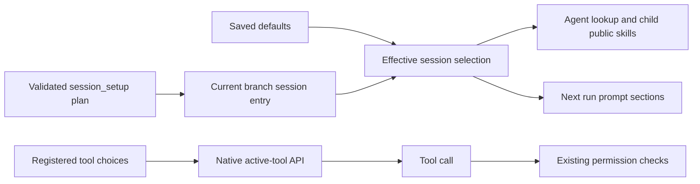

# Tools and commands

These are model-facing tools registered by the extensions. JSON examples are tool inputs, not shell commands. Tools require their owning extension in the current Pi process; security policy can additionally admit or refuse them.

## Secured shell writes

In active macOS host placement, the secured `bash` tool accepts optional `permissions.write: string[]` to request write
destinations outside the policy's default writable roots. Relative paths resolve from the
execution working directory. An existing directory requests its subtree; an existing or new file
path requests that file. Missing parent directories may be created without granting their contents.
Use an existing directory for tree-writing work, or supply exact file paths; glob paths are refused. Security does not infer shell destinations from the command.

```json
{
  "command": "printf '%s\\n' Passed > /workspace/service-b/notes/qa-summary.md",
  "permissions": { "write": ["/workspace/service-b/notes/qa-summary.md"] }
}
```

The resolver reviews the command and requested scope together. Approval binds the grant to that
call or its background job, within hard denials and resource limits; it does not change the saved policy.
A denied command bypasses review even when extra paths are supplied. The `write` and `edit` tools
infer a requested destination from `path` and need no extra path parameter. See
[per-call write scope](security-policy.md#requested-resources).

## Delegation tools

### Session setup

`session_setup` lets the parent choose registered resources for a task without writing project or
user settings. Either `pi-context` or `pi-delegation` provides it. Available selections depend
on the loaded contributors: `pi-context` supplies instructions; `pi-delegation` supplies
agents, skills and package groups. Loading one does not activate the other.
It searches trusted metadata using the same BM25 search as the resource picker. Skill bodies and
agent-owned skills/scripts are not returned by this search.
Manual-only skills are labelled; selecting one does not add its description to the native model
skill list or make its body load eagerly.

```json
{"op":"list","query":"evidence","kinds":["packages"],"limit":10}
```

Use exact returned package names, skill/agent names, instruction IDs and registered tool names:

```json
{"op":"apply","packages":["@finngi2/pi-evidence-research"],"tools":["read","write","bash","subagent","agent_list","subagent_check","subagent_close"]}
```

| Input | Effect |
|---|---|
| `op: "list"` | Inspect the effective selection and searchable available metadata; optional `query`, `kinds`, `limit` (1–50) |
| `op: "apply"` with `skills`, `agents`, `instructions` or `tools` | Replace each supplied category; omitted categories retain their selection; `[]` clears a category |
| `packages` on `apply` | Replace skills, agents and instructions with the packages' public members plus explicit same-call choices; `packages: []` clears those categories; tools are independent |
| `op: "reset"` | Remove the session override and use saved resource defaults again |

Package IDs are native `package.json` names, including any npm scope. Public skills excluded by
native package filters or CLI loading flags cannot be recovered by selecting their package.
Selecting `packages` changes only the public skill, agent and instruction sets, not executable
package loading. New packages use native `pi install` or a new invocation with `-e`; ordinary
extension changes require idle `/reload`. Native `-e` skills are individually selectable; stock
Pi 1.2 does not expose their package roots, so custom package grouping requires a saved declaration. Replacing security/runtime code or restarting processes
with children requires staged activation after those processes exit. Unknown package IDs return
these next actions without applying a partial selection. See [package decisions](../package-design.md).

The complete plan is validated before changes. Unknown, untrusted or unavailable IDs reject the
plan without a partial update. The tool remains available for inspecting or resetting the selection.
Registered tool results mark whether they are active or need native activation checks. Pi's CLI
filters can refuse activation; a refusal leaves the previous plan intact. Tools change through
Pi's native active-tool API and reach the next provider request in the same run. Instruction and skill prompt sections
change at the next run boundary, not midway through an existing model run; the receipt states this.
New child launches use the effective selected agents and public skills. Already-launched children
keep their prepared resources and user model pins still apply. Until the next parent run, new
children inherit that run's existing static instruction snapshot, not newly selected snippets.
Trusted agent definitions and their private bundle resources retain their normal discovery behavior:
source edits can affect future launches, while already-staged children retain their own copy.
Setup selects registered identities; it does not freeze authored bundles. The apply receipt includes
selected agents' current model pins and capability previews.

The override is stored as a native custom session entry, outside model messages. Resume restores
the current history branch's override; a new session uses saved defaults. Reset does not stop
children or delete artifacts. All four resource pickers change session choices only; Ctrl+S saves
project defaults and Ctrl+Shift+S saves personal defaults for new sessions across projects.
Project defaults take precedence, and recorded choices remain unchanged in resumed sessions.
A history branch without a selection entry records available defaults when first loaded; it cannot reconstruct older, unrecorded choices.
`reset` with `kinds: ["agents"]` resets only that category; other categories and active tools stay selected.

`/packages` provides a human-controlled session selection in the existing searchable resource
browser. Enter/Space toggles a package's available public skills, agents and instructions while
preserving unrelated individual selections. A partial marker means some, but not all, available
members are selected. In contrast, `session_setup` with `packages` replaces those categories.
Ctrl+S in `/packages` explicitly saves the current effective resource sets as project defaults in
trusted `.pi/settings.json`, including individual choices; native package declarations, tools and
permission settings stay unchanged. Ctrl+Shift+S saves personal defaults, excluding project-only resources. Individual pickers save only their category.

For example, open `/packages`, search `evidence` and toggle `@finngi2/pi-evidence-research`.
The next parent run receives the evidence-attribution instruction body, the `check-evidence`
skill description and location, and the `evidence-verifier` agent description and capabilities.
The model loads a skill body when it chooses to use it. A launched verifier receives its own agent
body and private `verify-claims` skill without advertising that private skill to the parent.
Close the picker to keep this session choice, or press Ctrl+S first to reuse it in new project
sessions. Neither action loads extension code or changes MCP connections.

Setup selects existing resources; it installs no extension, hook or MCP server and changes no
permission policy. A tool must be registered and available in the current Pi session. Native
deferred/codemode tools can remain callable while hidden from the active list, so this controls
presentation, not security. The normal security rules and permission resolver still check calls.
Custom policies can allow the registered `session_setup` tool explicitly; an unmatched call uses
their normal review path.



| Tool | Caller | Parameters | Result |
| --- | --- | --- | --- |
| `subagent` | Parent | `agent: string`, `task: string`; optional `model: string`, `conversation: string`, `workspace: "scratch" \| "project"` | Dispatch acknowledgement and effective resources |
| `agent_list` | Parent or child | `{}` | Reachable main/child identities, definition names, states |
| `agent_message` | Parent or child | `to: string`, `message: string`; optional `kind: "progress" \| "question" \| "message"`, `mode: "steer" \| "followUp"` | Broker/RPC acceptance receipt; not the recipient's answer |
| `subagent_check` | Parent | `id: string`; optional `after`, `limit` (1–4), `replySequence`, `textOffset` | State and one bounded page of retained replies; works for active and recently closed agents |
| `subagent_cancel` | Parent | `id: string`; optional `discard: boolean` | Stops process, collects files, returns a compact state/artifact summary |
| `subagent_close` | Parent | `id: string`; optional `discard: boolean` | Stops process, collects files, returns a compact state/artifact summary |

`workspace` defaults to `scratch`; `project` requires security disabled. `conversation` accepts `"none"`, `"all"`, or a positive integer string, subject to the definition ceiling. Routine `kind: "progress"` can target only the parent and never starts an idle parent turn. `question` and default `message` are actionable and can wake recipients. A receipt does not prove reading or revised-task acceptance. The inactive compatibility alias `subagent_message({id,message,mode?})` addresses a child; new prompts use `agent_message`.

Launch text uses `agent_id`, `name`, `status: "started"`, `workspace`, `workspace_mode`, `tools`, `scope`, and `request_id`. An accepted goal wait adds `wait_id`; launch details include `id`, `requestId`, `waitId`, `effective`, and `goalWait`. A message receipt uses `accepted`, `message_id`, `to`, and either `mode`, `kind`, and `trigger_turn` for the parent or `request_id` for a child, with `wait_id` if accepted by a goal. Main-message receipts do not wait for an answer.

Child replies are numbered and correlated with `requestIds`. `after` is a reply-sequence cursor, not a byte cursor. A check returns up to four replies and 32 KiB of reply text, with the complete serialized tool response capped at 32 KiB; each reply is limited to 8 KiB per page. If a reply continues, use its `sequence` as `replySequence` and its `nextTextOffset` as `textOffset` to read the next UTF-8 byte range. `nextAfter` advances only through complete replies returned by that page. Checks consume pending ordinary notifications only after contiguous pages from byte offset zero cover the full retained text and any longer queued delivery copy; retained history remains readable again. After close, JSON escaping can make the archive shorter than a queued reply, so paging that archive does not consume the larger pending notification. Results include state, usage, retention gaps and pagination fields. After close or cancel, up to four recent histories (8 MiB total, 30-minute lifetime) remain available in the same Pi session; shutdown, session-tree changes, session replacement, or eviction removes them. Automatic parent delivery is capped at 64 replies or a combined 4 MiB budget for XML-escaped result envelopes and gap notices; overflow drops the oldest pending notifications, emits a delivery-gap notice, and leaves retained child history available while it remains within the limits. A single envelope larger than the delivery budget is omitted and reported as a gap. Reply-panel usage is the total known when that message is delivered; later session-stat reconciliation appears in the current `subagent_check` snapshot and `/costs`. Failure, acknowledgement, and empty settlement do not become synthetic successful replies. Exact RPC state fields are in [RPC dialogue](../../packages/pi-delegation/lib/subagent/rpc-dialogue.ts).

Artifact descriptors contain `id`, `directory`, up to eight relative `files` and `omitted` path previews (128 characters each), full `fileCount`/`omittedCount` values, and `owned`. `moreFiles` and `moreOmitted` show how many paths were omitted; `truncatedPaths` counts previews clipped by length. `discard` deletes only an owned collected copy. Direct project references have `owned: false`. See [artifact collection](../guides/delegation.md#retain-and-integrate-artifacts).

### Dialogue limits

| Quantity | Limit |
| --- | --- |
| Message text | 64 KiB of UTF-8 bytes |
| Child instructions | 256 KiB of UTF-8 bytes; NUL refused |
| One retained reply | 2 MiB |
| Retained replies | 128 replies and 32 MiB |
| Undelimited child RPC input buffer | 4 MiB; oversize cancels the child |

Sources: [tool registration](../../packages/pi-delegation/extensions/subagent.ts), [message validation](../../packages/pi-delegation/lib/subagent/messages.ts), [resource validation](../../packages/pi-runtime/src/child-resources.ts), and [dialogue retention](../../packages/pi-delegation/lib/subagent/rpc-dialogue.ts).

## Codemode

Pi's `codemode` tool evaluates JavaScript in QuickJS and lets the model compose callable `tools.*`
operations. In a secured host session, load `builtin:codemode` and pass `--security-codemode`.
Security checks that the activated definition is the host's owned Pi built-in. A missing or
substituted definition refuses initialization.

Nested `tools.*` operations pass through the regular tool pipeline, with their own exact call IDs,
permission decisions, and confined effect helpers. MCP operations retain their owned-connection
and one-use ticket checks. Codemode `models.*` calls run through Pi's model client outside Seatbelt
and without individual permission-classifier decisions. Its QuickJS environment and the kernel
confinement of file/shell helpers are separate boundaries.

Use Pi's installed [documentation discovery](../guides/prompts.md#select-optional-skills) for the
codemode argument schema and JavaScript API. The pinned Linux/container artifact does not enable
codemode. See [security launch and limits](../guides/security.md#launch-from-the-checkout).

## Background process tool

`background_process({action, id?, cursor?, maxBytes?})` operates on processes owned by its active manager. `action: "list"` does not need an ID; `"status"`, `"read"`, and `"cancel"` require one. The model tool cannot launch a process or write stdin. Trusted extension clients use the separate [background service](events.md#background-service).

`cursor` is a nonnegative byte offset. `maxBytes` is a positive integer at most 1 MiB. Reads return a text preview, `nextCursor`, `retainedFrom`, and `gap`. Exact chunks in details carry stream, byte start/end, base64 data, and `encoding: "base64"`. A gap means earlier output was dropped from the bounded buffer.

| `pi-background` default transport limit | Value |
| --- | --- |
| Concurrent shell commands | 4 |
| Concurrent subagents | 16 |
| Retained jobs | 32 |
| Output retained per job | 16 MiB |
| Pending input bytes per job | 16 MiB |
| Pending writes per job | 128 |
| Result payload | 4 MiB |
| Kill grace / stream drain | 1 second each |
| Protocol write timeout | 30 seconds |

The `/jobs` command supports `list`, `read ID [CURSOR]`, and `cancel ID` for `pi-background` jobs. `/background` hands off foreground shell waits owned by `pi-background` and yields foreground goal waits; this does not stop their jobs or discard pending goal results. With `PI_SECURITY_TRANSPORT=extensions`, `pi-security` sends every secured shell call through this process manager. In that transport, foreground calls normally return output and exit details on completion; a steering message or `/background` ends the foreground wait and returns a job ID while the process continues. An explicit shell `background: true` also returns an ID immediately. The model tool lists secured shell jobs in this transport.

An explicit cancel, configured timeout, session shutdown, or natural completion ends a job. Timeout values are positive and capped at 2,147,483,647 ms (2,147,483.647 seconds), Node.js's maximum single timer delay. Session shutdown and cancellation terminate the process group; natural leader exit drains output for up to the configured drain limit before stopping remaining descendants. The security capability lease remains held until manager finalization. Shell commands and subagents have separate capacity pools, so long-lived agents do not consume shell slots. The class constructor accepts trusted limit overrides. Generic shell stdin is closed; protocol clients may request a pipe. Process groups do not contain deliberate daemon/session escapes. See the [process guide](../guides/background-processes.md). Sources: [tool](../../packages/pi-background/extensions/background-process.ts), [process manager](../../packages/pi-background/lib/background/processes.ts), and [output buffer](../../packages/pi-background/lib/background/output-buffer.ts).

## Goal tools

| Tool | Parameters | Behavior |
| --- | --- | --- |
| `create_goal` | `objective: string`; optional `criteria: string[]`; optional positive integer `budget`; optional `deadline: string` | Requests exact user confirmation or trusted preauthorization; deadline is a duration or timestamp; criteria default to the exact objective; cannot replace an unfinished goal |
| `get_goal` | `{}` | Reads objective/state and returns `id`, `revision`, `branchToken`, `status`, and fixed `criteria` in details |
| `wait_for_goal_event` | `id: string` | Waits for an acknowledged response offer in the current active authorized goal scope |

The worker can create an authorized goal, read its state, or wait for a producer-owned response.
There is no worker status setter. `/goal start <objective>` starts a goal with that exact objective
as its criterion; `/goal edit <objective>` replaces the criterion and clears earlier assessments.
Starting, editing, and resuming queue the authorized objective as the next user message. Pause and
resume are human controls.

A separate goal evaluator runs at a completed worker settlement with no outstanding owned wait.
It returns `finished`, `incomplete`, or `blocked` and assesses every criterion. `finished` requires
all criteria to be `met`. Three consecutive fresh evaluations of the same unresolved blocker stop
automatic work; waits do not count. Evaluator errors disarm automatic continuation but leave manual
messages available without goal instructions. See [goal assessment](goals.md#assessment-and-completion).

A completed evaluator response that fails validation gets one corrective attempt with a bounded
excerpt of the invalid response, under the original timeout. Provider, authentication, abort,
timeout, or response-length failures do not retry; a second invalid response disarms continuation.

An explicit budget covers parent-provider usage on main-model calls, checked before every provider dispatch, including tool loops. The current run retains its goal authority through completion or blocking, so a later tool-loop call is stopped locally and returned as an aborted continuation reason before provider dispatch. One already-dispatched request can finish after a pause or overshoot the limit. Missing or incomplete usage stops automatic continuation for an explicit budget. Omitted budget means unlimited and hides accumulated totals from model context; `/goal status` shows accounting. The shipped child producer returns `wait_id`; `pi-background` does not itself offer goal waits. See the [goal guide](../guides/goals.md) for workflow and [goal services](events.md#goal-services) for authorization, request, and wait contracts. Sources and checks: [goal extension](../../packages/pi-goal/extensions/goal.ts), [request admission](../../packages/pi-goal/lib/continuation.ts), [persistence](../../packages/pi-goal/lib/persistence.ts), [serialized-context fixture](../../packages/pi-goal/lib/serialized-context.test.ts), and [wait integration](../../packages/pi-goal/lib/waiter-integration.test.ts).

## Search tool

`codex_search` accepts:

| Parameter | Values |
| --- | --- |
| `queries` | 1–32 nonempty strings, each at most 2,000 characters |
| `search_context_size` | `"low"`, `"medium"`, or `"high"`; default `"medium"` |
| `freshness` | `"live"`, `"cached"`, or `"indexed"`; default `"live"` |

It resolves OpenAI Codex OAuth through Pi's `modelRegistry.getProviderAuth("openai-codex")` and derives account identity from that token. Missing account claims fail with sign-in guidance. It does not use an ambient credential file or fork-only metadata API.

Without security selection/presence, it uses its fixed backend protocol directly. With security, it requires exactly one valid `prepareSearch` capability before resolving auth or dispatching HTTP. The capability binds exact input, network permissions, `chatgpt.com` authority, fixed origin, allowed model/Responses paths, lifetime, and cancellation. Missing/invalid/duplicate service or failed admission refuses; it cannot bypass a gate.

Output contains model, optional submitted reasoning effort, freshness, context size, query/failure counts, `successes`, `failures`, `partial`, and elapsed time. Each success has text, provider URL citations, search calls, and optional usage/response ID/truncation flag. Failures classify auth, rate-limit, transport, timeout, schema, or unknown errors. Cite URLs the provider actually returns; an empty citation list supplies no sources.

| Search bound | Value |
| --- | --- |
| Concurrent queries | At most 5 |
| Request and reader deadline | 60 seconds per request |
| Model JSON | 1 MiB |
| SSE data | 2 MiB per query |
| Individual SSE frame | 1 Mi characters |
| Returned answer text | 12,000 characters, with explicit truncation |

Redirects are refused. The parser requires the terminal completion marker and validates optional primitive fields. This is a trusted HTTP adapter outside kernel effect-tool network confinement; cancellation/revocation aborts transport and rejects stale updates/results. Source and tests: [tool/auth/security adapter](../../packages/pi-codex-search/extensions/search.ts), [protocol](../../packages/pi-codex-search/lib/search.ts), and [tests](../../packages/pi-codex-search/tests/search.test.ts).

## Commands

| Command | Owner | Purpose |
| --- | --- | --- |
| `/agents` | `pi-delegation` | Browse definitions, effective settings, and diagnostics |
| `/agents trust [directory]` | `pi-delegation` | Interactive session-only trust for a discovered ancestor |
| `/skills` | `pi-delegation` | Browse Pi's selected skill registry |
| `/packages` | `pi-delegation` | Toggle loaded package guidance for this session; Ctrl+S saves project defaults; Ctrl+Shift+S saves personal defaults |
| `/goal <objective>` | `pi-goal` | Start or replace the goal, then queue its objective as a user message |
| `/goal` or `/goal status` | `pi-goal` | Inspect goal state and accounting |
| `/goal start <objective>` / `/goal edit <objective>` | `pi-goal` | Start or replace the goal, then queue its objective as a user message |
| `/goal clear` | `pi-goal` | Remove the goal and revoke its old waits and automatic continuation |
| `/goal pause` / `/goal resume` | `pi-goal` | Pause or resume automatic continuation |
| `/jobs [list]` | `pi-background` | List session background jobs |
| `/jobs read ID [CURSOR]` / `/jobs cancel ID` | `pi-background` | Read output or cancel a session background job |
| `/background` | `pi-background` | Yield `pi-background` foreground shell waits and goal waits while preserving their pending work |
| `/costs` | Shared accounting installed by subagents/security | Show combined total, parent/agent/classifier/evaluator breakdowns and missing-usage limitations |
| `/mcp` | Pi built-in MCP integration under `pi-security` | Manage opted-in HTTP(S) MCP servers and Pi-owned authentication; requires `--security-mcp` for config admission |

The `/goal` shorthand treats `start`, `edit`, `pause`, `resume`, `clear`, and `status` as controls when they are the first word. Put an objective beginning with one of those words after explicit `/goal start`.

The standalone `pi-security explain "<command>"` CLI reports policy matching without execution or classification. See [configure security](../guides/security.md#inspect-decisions-and-failures).


## Secured MCP

`--security-mcp` explicitly enables Pi's built-in MCP integration in the host. The adapter retains Pi's `/mcp` manager, OAuth provider, server connections, and tool catalogue. Only admitted HTTP(S) endpoints can connect; each model tool/resource call is approved by the normal security decision flow and bound to the selected server, exact Pi tool-call ID, and MCP operation before SDK execution. Redirects and local stdio configs are refused. Default exposure is `deferred` and requires `builtin:tool-search`; configured codemode exposure is supported when the host explicitly activates codemode. MCP configuration does not activate it automatically. Explicit SDK OAuth helper fetches are host-scoped to `policy.resources.network`; the SDK's saved-token preflight may refresh against its saved issuer before the transport gate, so this is not full OAuth-network confinement. See [security guidance](../guides/security.md#launch-from-the-checkout).
